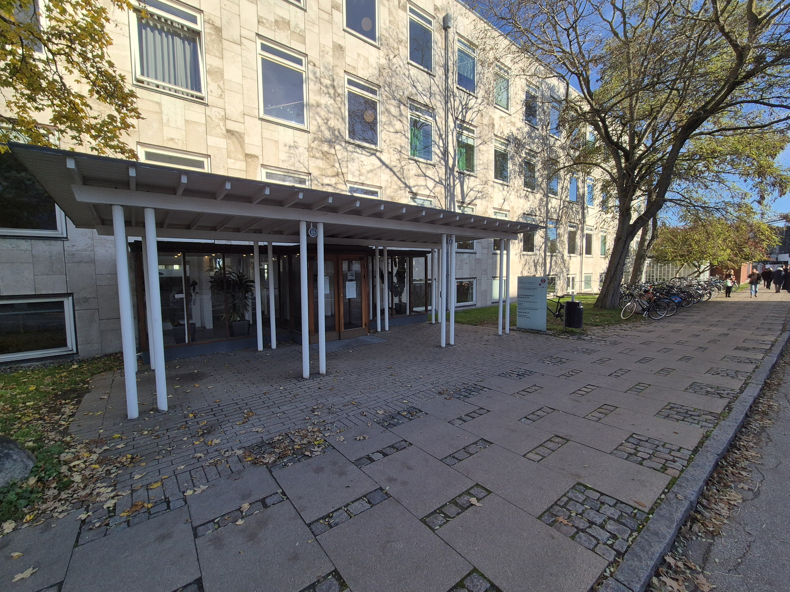

# Course program

[Course overview](README.md)

**AI- & data-driven drug design – An introduction**

**9–13 November 2026 · University of Copenhagen**

Each day has a focus topic, with lectures **09:00–12:00**, lunch **12:00–13:00**, and a hands-on workshop **13:00–17:00**. Items marked TBD remain to be confirmed.

## Location

**Address:** Jagtvej 158 (see photo)  
**Room:** U21  
**Way:** Enter the building via the double door, go down the stairs and 15 metres to the right.  
If you need help, contact course leader, David Gloriam: 93 56 54 49

| Day | Date | Topic | Materials |
| --- | --- | --- | --- |
| 1 | 9 November | Databases | [Day 1](day01/README.md) |
| 2 | 10 November | Structure-based drug design (small molecules) | [Day 2](day02/README.md) |
| 3 | 11 November | AI/ML tools for drug design (peptides & proteins) | [Day 3](day03/README.md) |
| 4 | 12 November | Data visualization | [Day 4](day04/README.md) |
| 5 | 13 November | Data analysis using AI/ML | [Day 5](day05/README.md) |

## Day 1 (Nov 9) – Databases

[Day 1 description and materials](day01/README.md)

| Session | Time | Content | Teacher | Affiliation |
| --- | --- | --- | --- | --- |
| Lecture 1 | 09:00 | Course introduction Information and participant presentation | David Gloriam | ILF, UCPH |
| Lecture 2 | 10:00 | Drug, target and disease databases ClinicalTrials.gov, ChEMBL, DrugBank, DrugCentral, OpenTargets, Pharos, PubChem, Therapeutic targets database, (GPCRdb, GtoPdb, KLIFS), GTEX? | Javier Lorente | ILF, UCPH |
| Lecture 3 | 11:00 | Industrial talk TBD | TBD | Amass |
| Workshop 1 | 13:00–17:00 | Hunt for drug, target and disease data Find drug, target and disease data – either following a workshop material or related to your own project. | Javier Lorente, Søren Norge Andreasen, Aidan Flynn, David Gloriam | ILF, UCPH |

## Day 2 (Nov 10) – Structure-based drug design (small molecules)

[Day 2 description and materials](day02/README.md)

| Session | Time | Content | Teacher | Affiliation |
| --- | --- | --- | --- | --- |
| Lecture 4 | 09:00 | The structure-based drug design toolbox Docking, LigPlot, SiteMap etc. | David Gloriam | ILF, UCPH |
| Lecture 5 | 10:00 | Computational hit identification & hit-to-lead optimization Compounds properties being optimized and case story. | Henrik Daver | Lundbeck A/S |
| Lecture 6 | 11:00 | Drug-target molecular interactions Molecular interactions (H-bonds etc.), shape fit and its role in selectivity etc. | David Gloriam | ILF, UCPH |
| Workshop 2 | 13:00–17:00 | Structure-based ligand optimization Competition to build the best drug | Kasper Harpsøe, Icaro Simon, Pablo Macho, Jody Pacalon, David Gloriam | ILF, UCPH |

## Day 3 (Nov 11) – AI/ML tools for drug design (peptides & proteins)

[Day 3 description and materials](day03/README.md)

| Session | Time | Content | Teacher | Affiliation |
| --- | --- | --- | --- | --- |
| Lecture 7 | 09:00 | Software for protein modeling & peptide drug design AlphaFold, Rosetta, ProteinMPNN, BindCraft … | Albert Kooistra | ILF, UCPH |
| Lecture 8 | 10:00 | Industry’s toolbox and case story Commercially used methods and case stories | Rodrigo Alonso Ochoa | Novo Nordisk A/S |
| Lecture 9 | 11:00 | AI-/ML-based peptide design at Gubra | Kasper Einarson | Gubra |
| Workshop 3 | 13:00–17:00 | Protein modeling and peptide design Build a protein model and design peptide/mini-protein binders. Use of AlphaFold, Boltz etc. and maybe Colab notebook. | Albert Kooistra, Jody Pacalon, Jonas Verhellen, David Gloriam | ILF, UCPH |

## Day 4 (Nov 12) – Data visualization

[Day 4 description and materials](day04/README.md)

| Session | Time | Content | Teacher | Affiliation |
| --- | --- | --- | --- | --- |
| Lecture 10 | 09:00 | Data visualization theory How the brain sees patterns: shape, position, color and size. Which graph for which data? | Sarah Mittenentzwei | TBD |
| Lecture 11 | 10:00 | Visualization in popular science | Karen Grubbe | Illustreret videnskab |
| Lecture 12 | 11:00 | Scripting tools for data visualization Tool tips to get started | Alexander Hauser | ILF, UCPH |
| Workshop 4 | 13:00–17:00 | Data visualization workshop Using Claude | Sarah Mittenentzwei, Javier Lorente, David Gloriam, Jascha Henseler, Jacob Fredegaard Hansen | ILF, UCPH |

## Day 5 (Nov 13) – Data analysis using AI/ML

[Day 5 description and materials](day05/README.md)

| Session | Time | Content | Teacher | Affiliation |
| --- | --- | --- | --- | --- |
| Lecture 13 | 09:00 | Data processing / preparation Features for small molecule and peptides, descriptors, data formats, transformation, normalization | Wouter Boomsma | DIKU, UCPH |
| Lecture 14 | 10:00 | Predictive ML | Jakob Madsen | ILF, UCPH |
| Lecture 15 | 11:00 | Industrial data analysis and case story | Lars Juhl Jensen | ZS discovery |
| Workshop 5 | 13:00–16:30 | Data analysis workshop Using Claude | Arnault-Quentin Vermillet, Jascha Henseler, Jacob Fredegaard Hansen, Lykke Pedersen, David Gloriam | ILF, UCPH |
| Wrap-up | 16:30–17:00 | Wrapping up the course Tips of next-level courses and course evaluation. | David Gloriam | ILF, UCPH |
