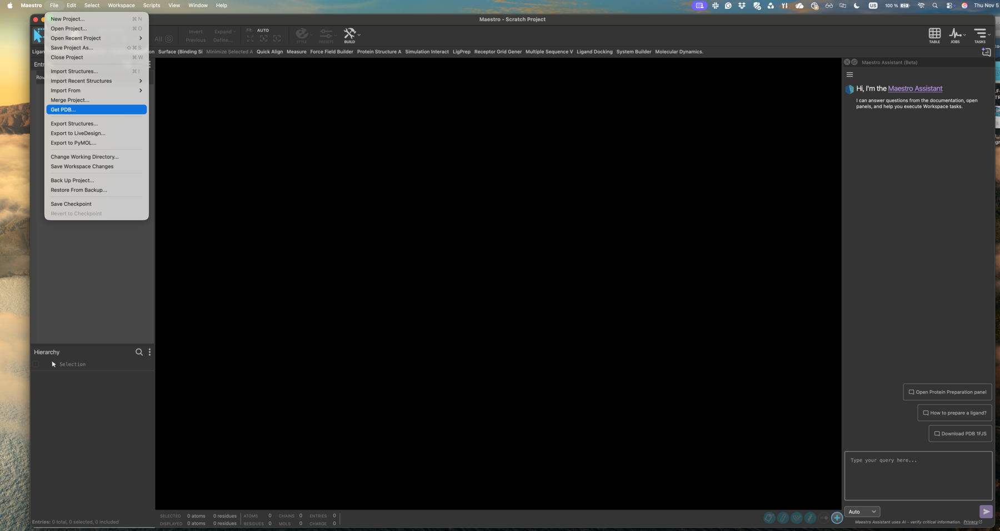
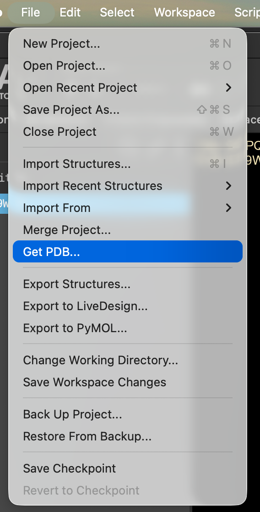
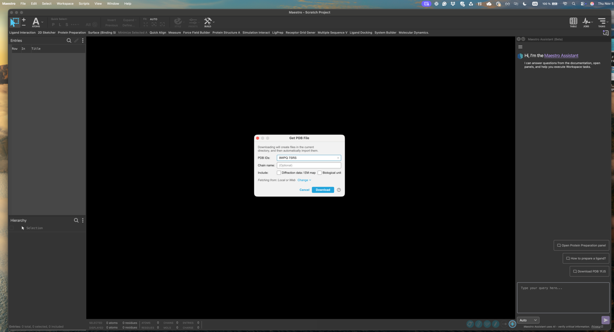
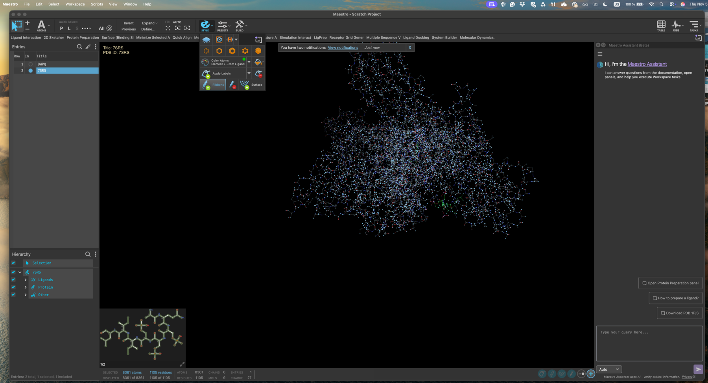
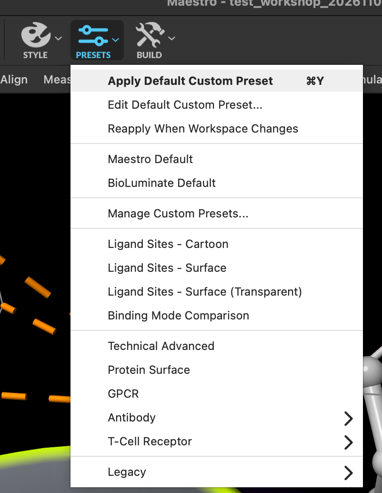
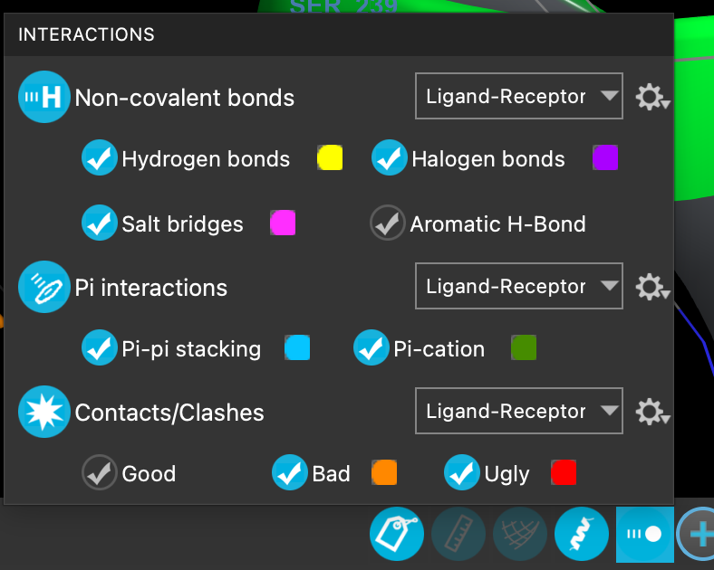
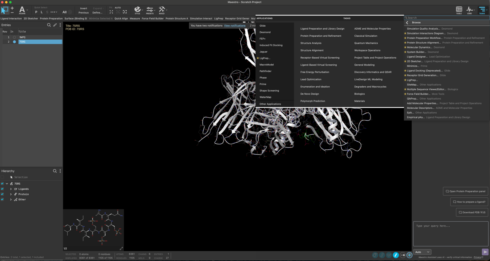
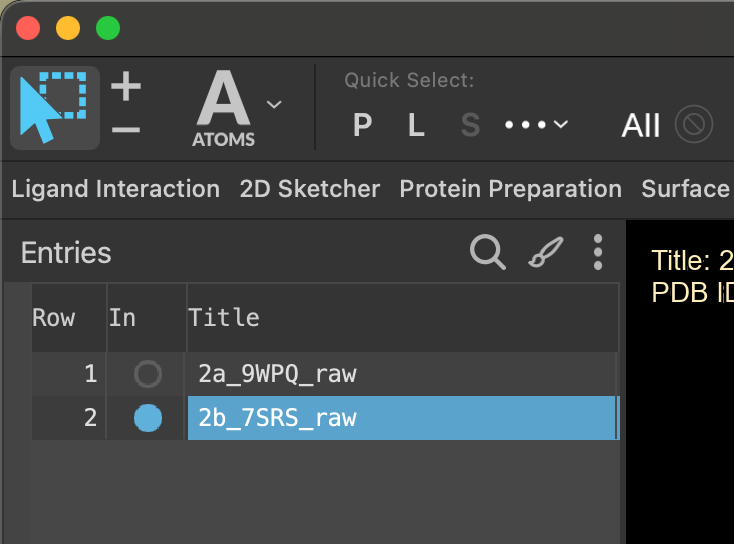

# 01 · Get to know Maestro

**Goal:** get both receptors on screen, and learn the controls by using them.

Most panels in Maestro stay greyed out until something is loaded, so start by fetching the structures.

## Fetch the two structures

1. Go to **File → Get PDB**.

2. Enter both PDB IDs — **9WPQ** and **7SRS** — and click **Download**.

These are the LSD-bound structures of your two targets: 9WPQ is 5-HT2A, 7SRS is 5-HT2B. Both arrive with everything the crystallographers needed and plenty you do not.

## Look around

3. Use the **STYLE** ribbon to change how structures are drawn.

4. Open **PRESETS** and apply one. A preset sets a whole display scheme in one click, which is how you will get comparable views of both receptors later.

5. In the bottom right corner, turn on **display interactions** to see contacts between LSD and the receptor.

6. Open **TASKS** and search. Everything you run today lives here — Protein Preparation, LigPrep, Receptor Grid Generation, Ligand Docking. Have a look at what else is in there.

> 💬 **Stuck on the interface?** Open the Maestro Assistant (chat icon, top right) and ask it. [Maestro basics](maestro-basics.md) has the panel map, the mouse controls and the cheat sheets.
> {: .tip }

## Name your entries now

7. Rename the two entries to **`2a_9WPQ_raw`** and **`2b_7SRS_raw`**.

By the end of the day you will have a dozen or more entries with similar names. Groups that keep a naming convention finish; groups that do not spend the last hour working out which structure is which.

> **Discuss** — in the Project Table, what is the difference between an entry being *selected* and being *included*? Try both and watch the Workspace. Which one do you think a task like docking will use as its input?
> {: .discuss }

**Checkpoint**

- [ ] Both 9WPQ and 7SRS are loaded.
- [ ] You can rotate, zoom and fit the view.
- [ ] You have seen LSD's interactions in at least one structure.
- [ ] The entries are named `2a_9WPQ_raw` and `2b_7SRS_raw`.

[Workshop home](index.md) · [Next: create a project](02-Create-project.md)
