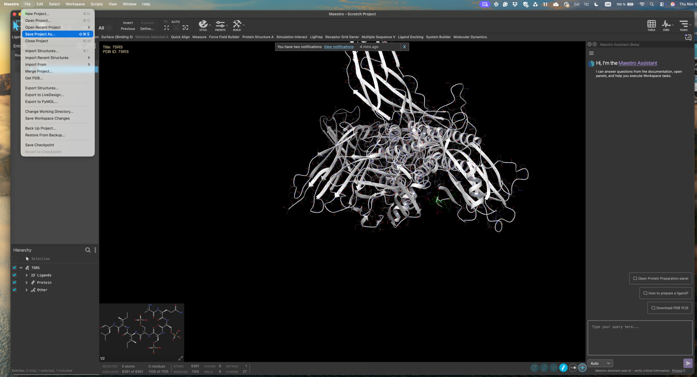
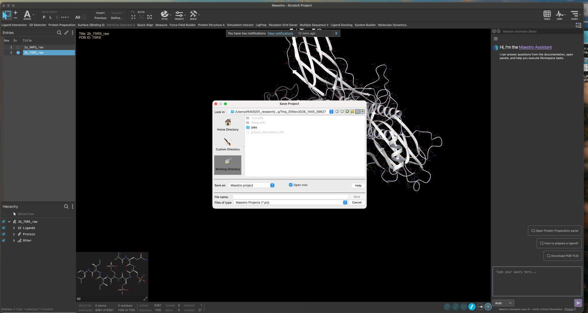
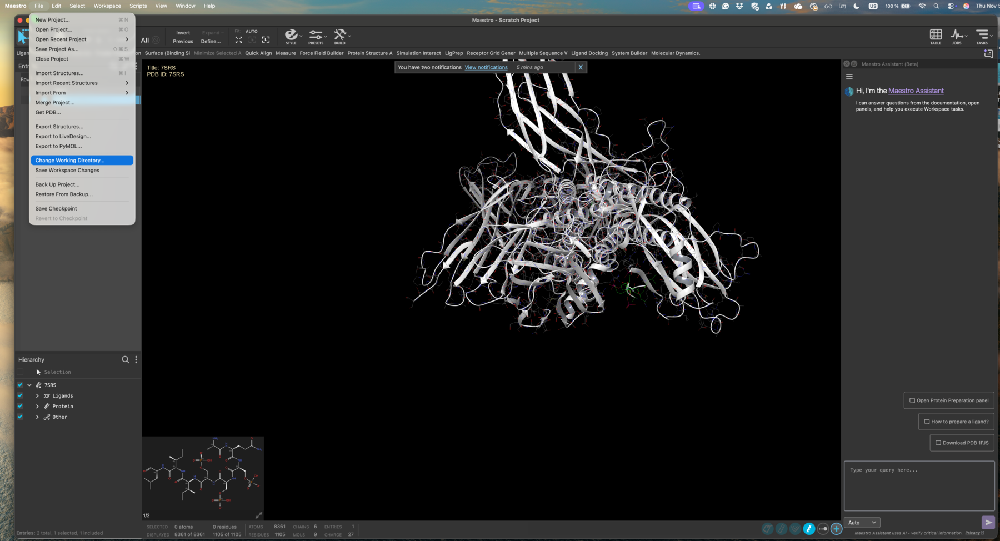

# 02 · Create and save the project

**Goal:** everything your group produces today lands in one findable place.

So far you have been working in a scratch project. Give it a name and a home.

## Save the project

1. **File → Save Project As**.

2. Name it after your group, for example `G4_workshop`. Use the same group number as the dropdown in the submission app, with no leading zero, so that one label follows you from the project name to your compound IDs.

3. Set the **project directory** to your group folder, so that job output lands next to the project instead of somewhere in your home directory.

Maestro auto-saves from here on. You do not need to keep saving manually, but you do need to keep track of what each entry is.

## Agree on names before you need them

Use descriptive titles and extend them as structures change:

| Stage | Entry title |
| --- | --- |
| As downloaded | `2a_9WPQ_raw` |
| Chains removed | `2a_9WPQ_edit` |
| After Protein Preparation | `2a_9WPQ_prep` |

The same for `2b_7SRS_*`. Later, your ligands and docking runs get your group number as a prefix — `G4_ligprep-out`, `G4_docking_2a_9wpq_pv`.

## Nothing else to write down

There is no worksheet to fill in. The submission app keeps your compounds and their IDs, and the [selectivity calculator](selectivity.md) does the arithmetic on your docking scores at the end. Spend the day looking at structures and talking to each other instead.

> 💬 **The mouse does not have to stay as it is.** You can remap every mouse action, including a PyMOL-style mode. See [Maestro basics](maestro-basics.md#if-the-mouse-feels-wrong).
> {: .tip }

**Checkpoint**

- [ ] The project is saved under your group name.
- [ ] The project directory points at your group folder.
- [ ] Everyone in the group knows the naming convention.

[Previous](01-Get-to-know-Maestro.md) · [Workshop home](index.md) · [Next: clean the structures](03-Clean-structures.md)
