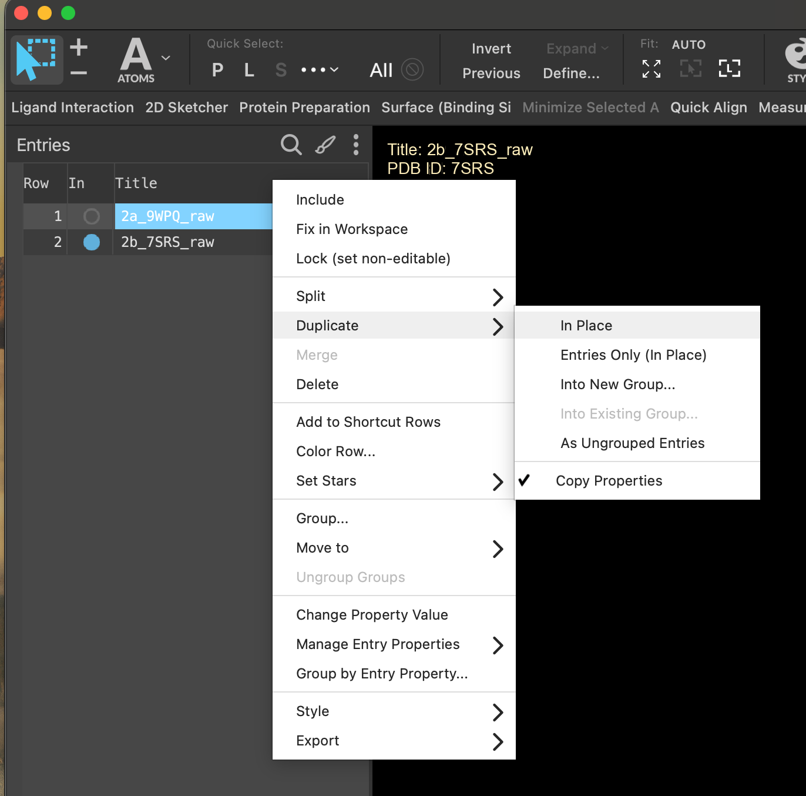
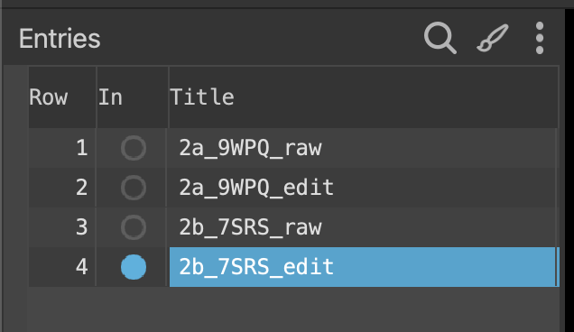
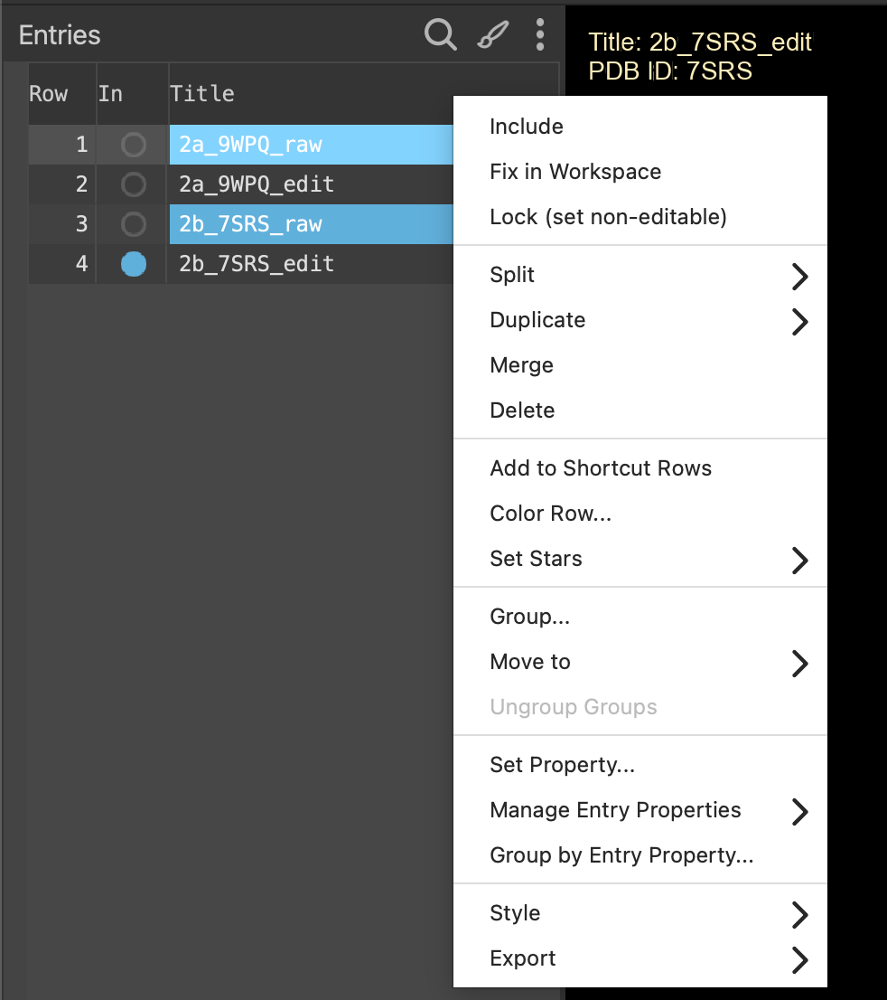
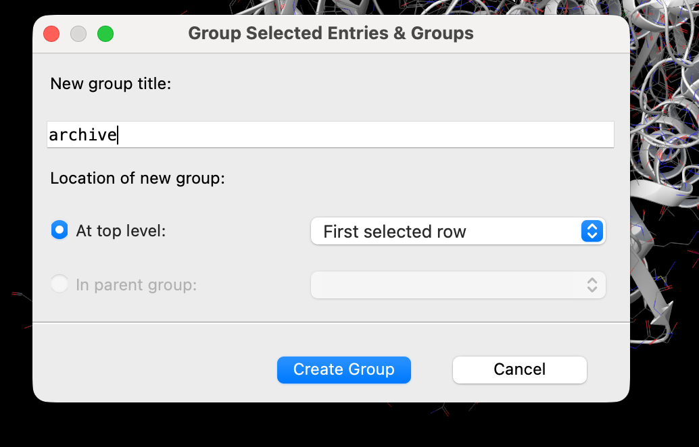
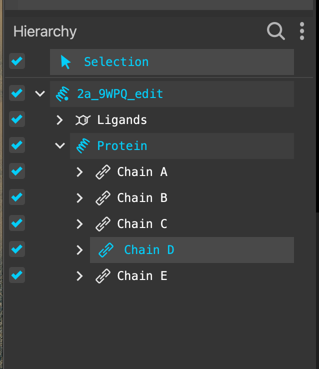
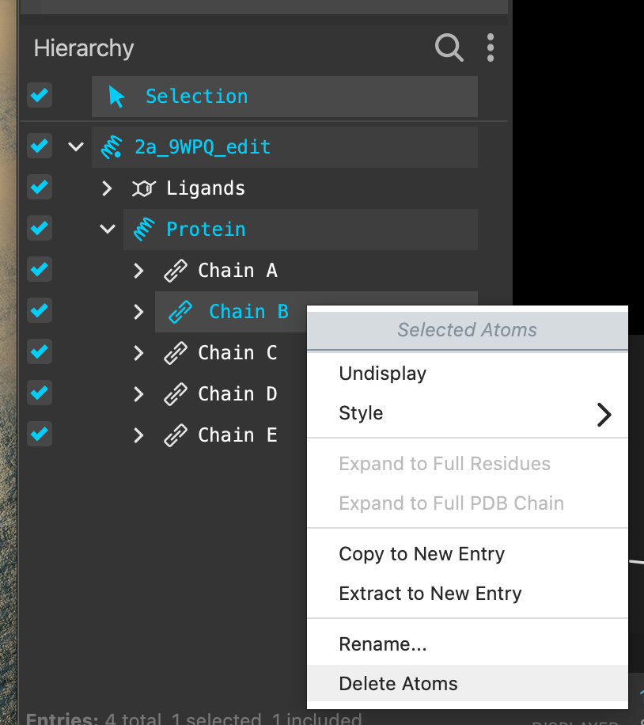
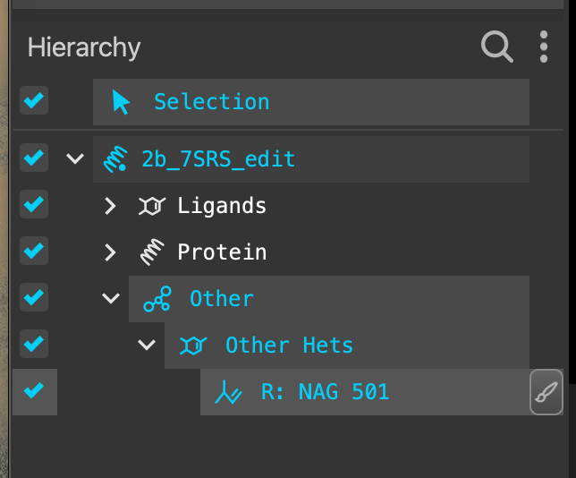
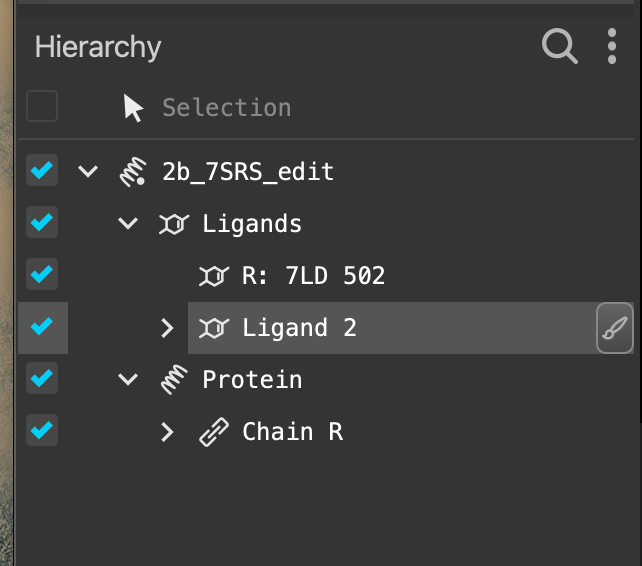

# 03 · Clean the structures

**Goal:** one receptor plus LSD in each working entry, and nothing else.

A deposited structure contains whatever was needed to get a picture: G proteins, antibodies, waters, lipids, buffer. For docking you want the receptor and its ligand.

## Work on a copy

1. Right-click each entry and choose **Duplicate → In place**. Do this for both structures.

2. Rename the duplicates from `raw` to **`edit`** — `2a_9WPQ_edit` and `2b_7SRS_edit`.

3. Select both `raw` entries (hold `Ctrl`/`Cmd`), right-click, and put them in a **New group** called `archive`.

Deleting atoms is not undoable once you have moved on. The archive is your way back.

## Delete what you do not need

4. Include one `edit` entry. In the **Hierarchy** panel, work through the chains one at a time and watch which atoms highlight in the Workspace.

5. Delete everything that is not the receptor or LSD: the G protein or arrestin, antibody chains, waters, lipids and buffer components.

6. Repeat for the second structure.

7. In **7SRS** there is a second "ligand" that is actually a phosphopeptide from the receptor C-terminus. It sits far from the LSD site, so remove it too.

> **Discuss** — you have just deleted the G protein and arrestin. Those proteins were bound to the receptor for a reason. What does their presence tell you about the *state* each receptor was captured in, and does removing them change the pocket you are about to dock into?
> {: .discuss }

> **Not sure whether something belongs?** Waters, lipids and buffer go. Disulfides stay. If you find a covalent modification or something that looks like a cofactor, ask an instructor rather than guessing.
> {: .warn }

**Checkpoint**

- [ ] Both `raw` entries are safe in the `archive` group.
- [ ] Each `edit` entry shows one seven-helix receptor with LSD in the pocket.
- [ ] No transducer, antibody or peptide chains remain.
- [ ] The Hierarchy confirms it — not just the picture.

[Previous](02-Create-project.md) · [Workshop home](index.md) · [Next: run the diagnostics](04-Protein-diagnostics.md)
