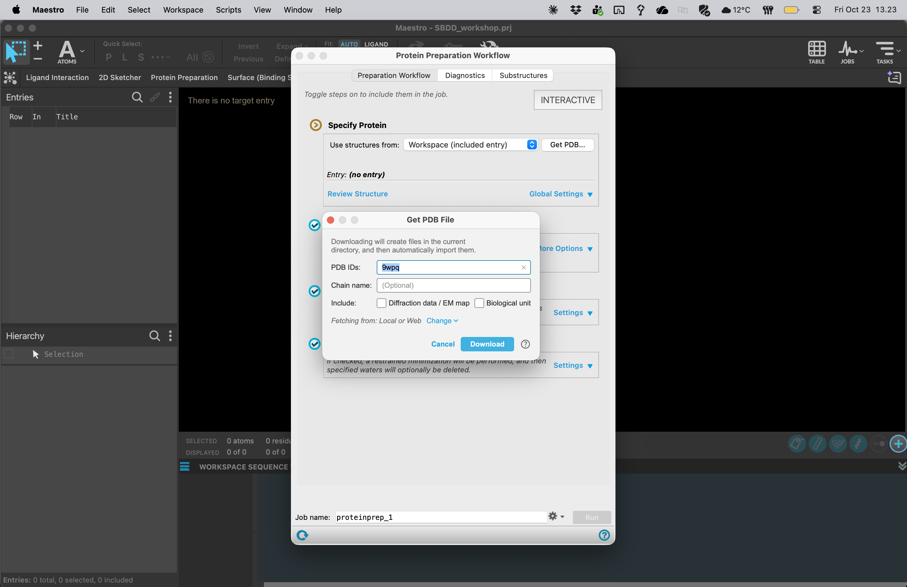

# 03 · Fetch the LSD-bound structures

**Goal:** import both experimental complexes before editing them.

| Receptor | PDB ID | Experimental complex | Resolution |
| --- | --- | --- | --- |
| 5-HT2A | **9WPQ** | LSD, mini-Gq complex and scFv16 | 3.15 Å, cryo-EM |
| 5-HT2B | **7SRS** | LSD, β-arrestin-1 and antibody fragments | 3.30 Å, cryo-EM |

The structure identities and experimental details are listed at [RCSB 9WPQ](https://www.rcsb.org/structure/9WPQ) and [RCSB 7SRS](https://www.rcsb.org/structure/7SRS).

1. Open **TASKS → Protein Preparation Workflow**.
2. In **Specify Protein**, choose **Get PDB**. Enter **9WPQ** and download the coordinates. You do not need the EM map for this exercise.
3. Rename the imported entry `2A_9WPQ_raw`.
4. Repeat for **7SRS** and name it `2B_7SRS_raw`.
5. Include one entry at a time, show protein ribbons, and locate the small molecule **7LD**, the PDB chemical-component identifier for LSD in these structures.
6. Duplicate each entry to make a working copy. Exclude the raw entries from the Workspace and keep them in the project.

Check the order of the letters: **9WPQ**. Verify the downloaded structure's title rather than relying on the ID alone.

These complexes capture different transducer-associated receptor conformations. Pocket differences may reflect receptor state, experimental uncertainty or construct differences as well as subtype sequence. Keep this limitation in mind when proposing selectivity mechanisms.

**If download fails:** ask for the instructor's coordinate files and import them with **File → Import Structures**. Confirm the same PDB IDs and titles.

**Checkpoint:** two untouched raw entries and two working copies, with LSD identified in each.

[Previous](02-Create-project.md) · [Home](index.md) · [Next: diagnostics](04-Protein-diagnostics.md)
