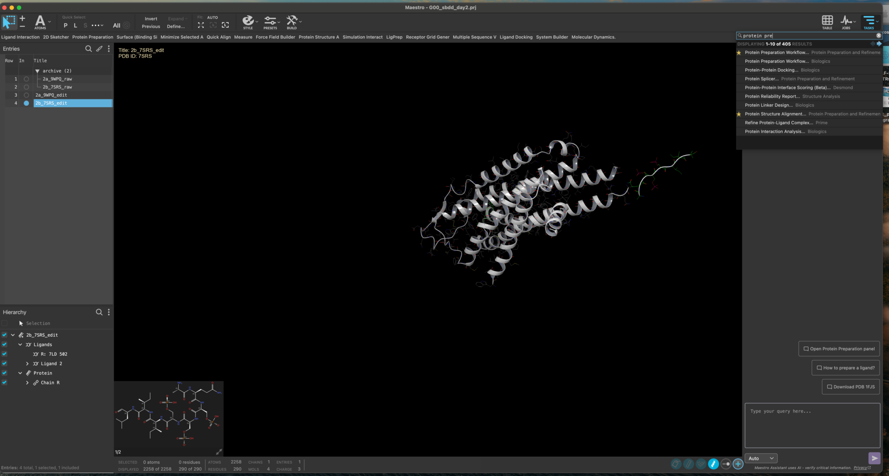
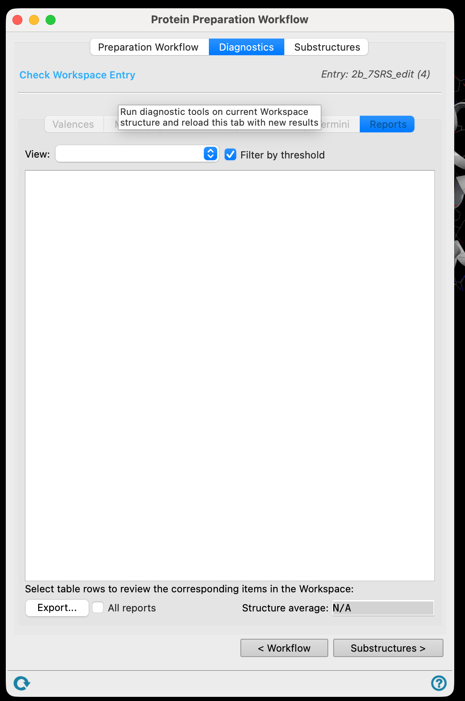
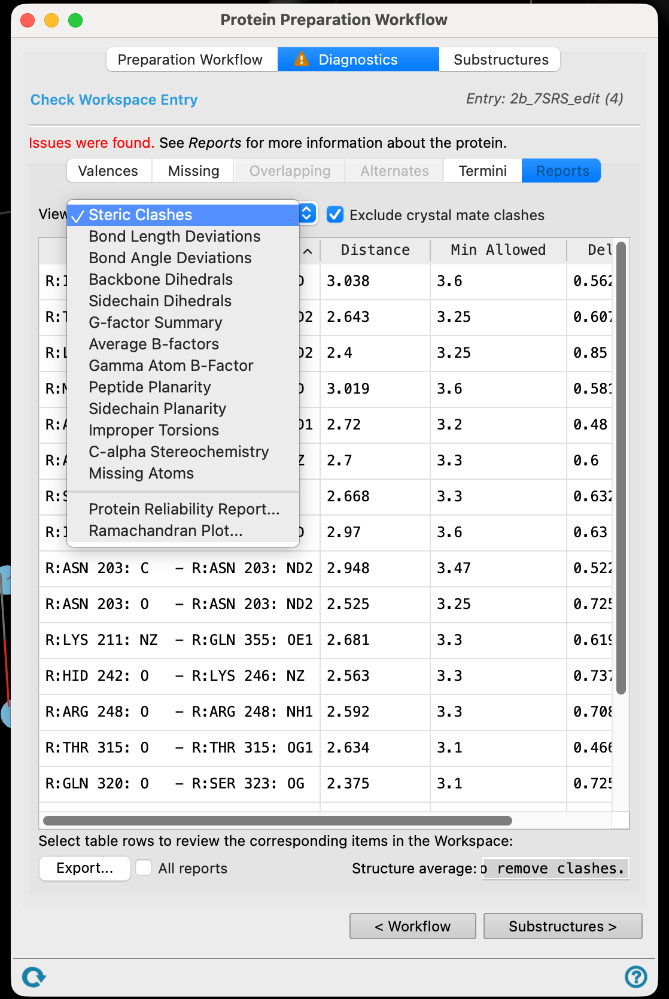
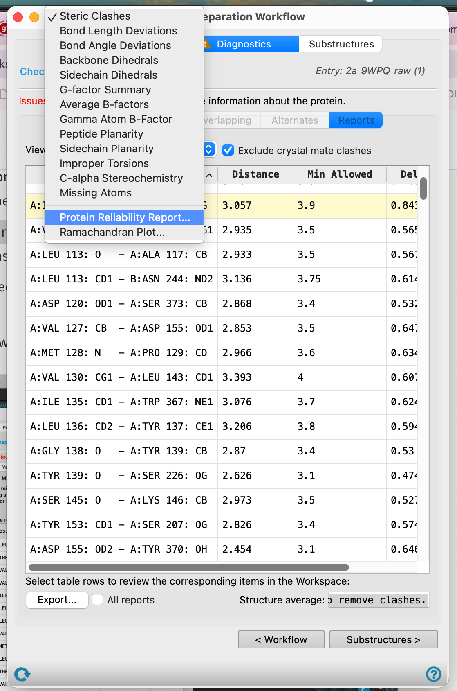
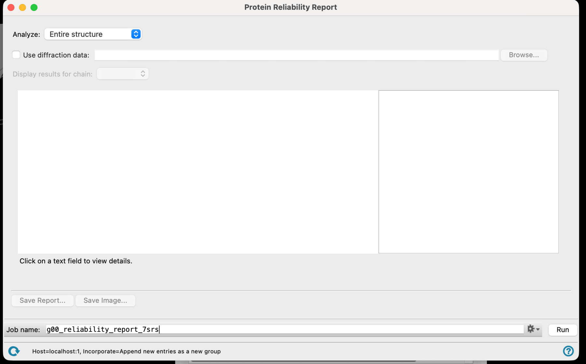
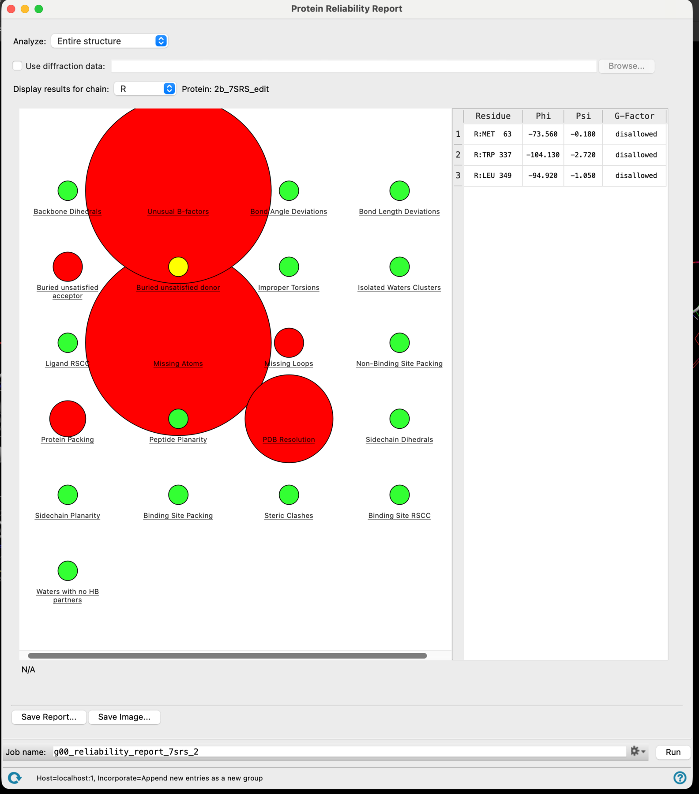
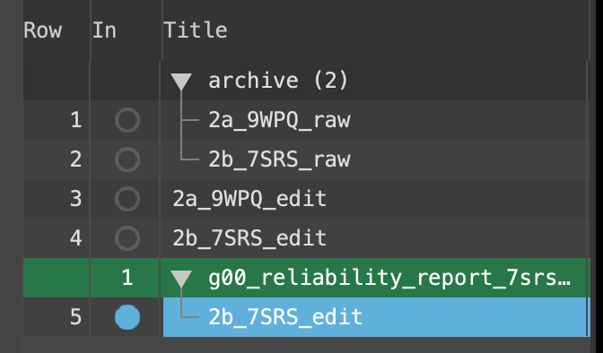

# 04 · Run the diagnostics

**Goal:** find out what is actually wrong with the structures before you trust them.

An experimental structure is a model fitted to density. Parts of it are certain, parts are guesses, and some atoms are simply missing.

## Check the workspace entry

1. In **TASKS**, search for **Protein Preparation Workflow** and open it.

2. Go to the **Diagnostics** tab and click **Check workspace entry**.

3. Work through the issues it reports.

> **Discuss** — take the main problems one at a time. What does each one actually mean for a docking calculation? Missing side chains near the pocket are not the same problem as a missing loop on the other side of the protein. Which of these would change your results, and which are cosmetic?
> {: .discuss }

## The reliability report

4. In **TASKS**, open the **Protein Reliability Report**.

5. Choose to analyse the entire structure, give the job a name, and **Run**.

6. Open the report when it finishes and click through the flagged regions.

> **Discuss** — click on the problems the report flags. What is it complaining about? Does anything it found sit in or near the LSD binding site?
> {: .discuss }

7. Close the report and **delete the structures it generated**. You will not dock into them, and they clutter the Project Table.

**Checkpoint**

- [ ] Diagnostics have been run on both structures.
- [ ] Your group can name the main problems in each one.
- [ ] You know whether any of them affect the binding site.
- [ ] The reliability report entries are deleted.

[Previous](03-Clean-structures.md) · [Workshop home](index.md) · [Next: prepare the proteins](05-Prepare-proteins.md)
