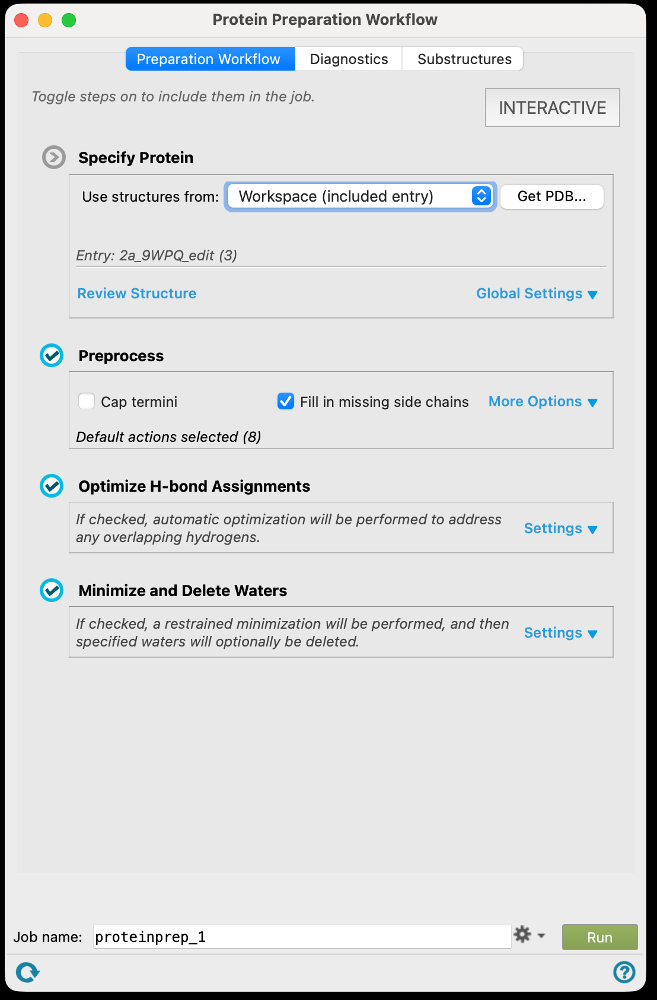
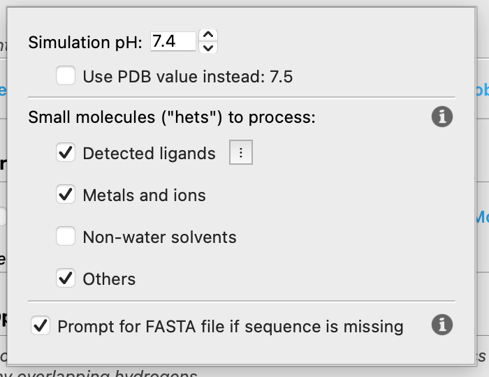
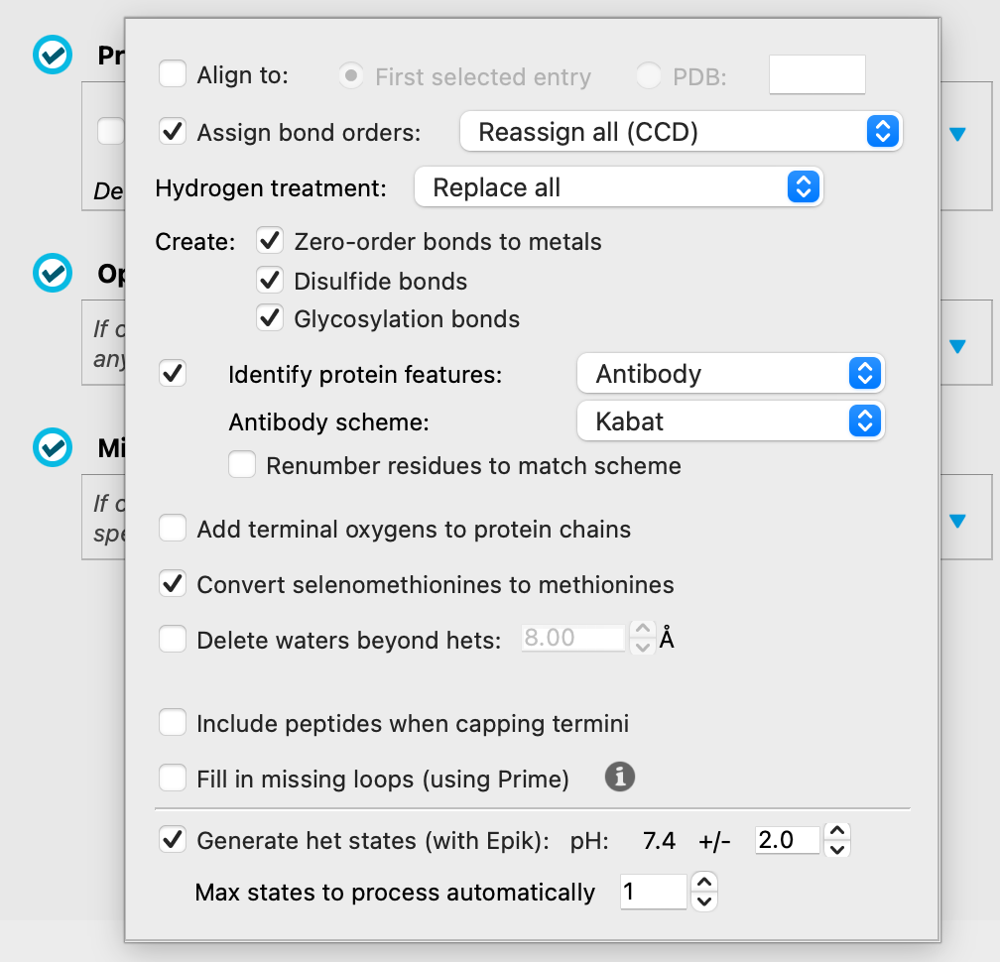
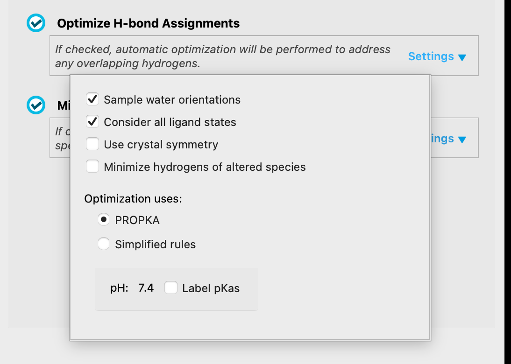
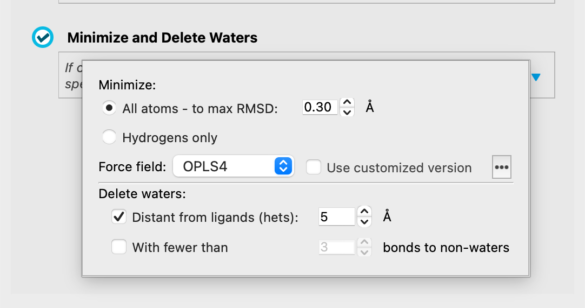
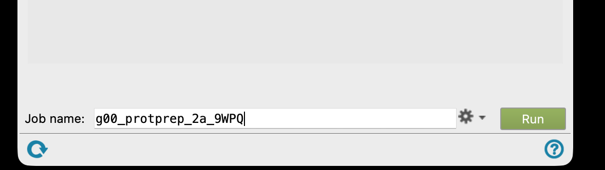
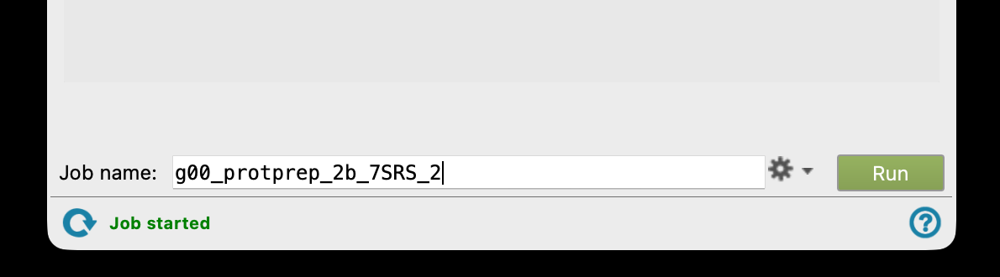
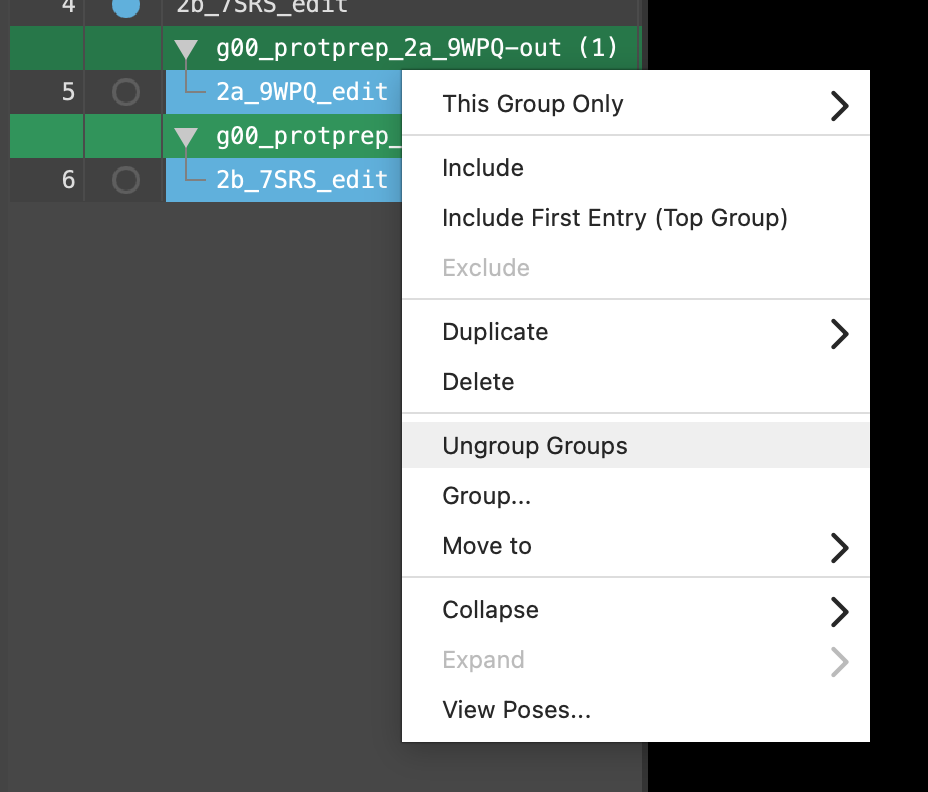
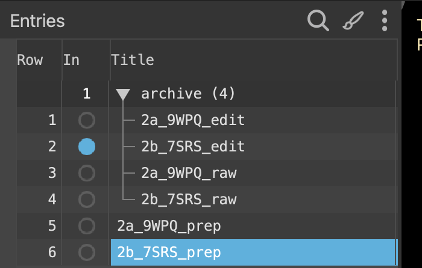

# 05 · Prepare the proteins

**Goal:** turn two deposited structures into something a force field can work with.

X-ray and cryo-EM structures have no hydrogens, ambiguous side-chain flips and unassigned protonation states. Protein Preparation fixes all of that.

## Set up the run

1. Open the **Protein Preparation Workflow** again if you closed it.

2. Take the structure from **Included entries**, and check the global settings.

3. Work through the three option blocks.

## What these settings do

| Setting | What it does | Why it matters here |
| --- | --- | --- |
| **Fill in missing side chains / loops** | Rebuilds residues that were not resolved, using Prime | A missing side chain in the pocket is a hole your ligand will happily fall into |
| **Cap termini** | Adds neutral caps to chain ends | Stops artificial charges at breaks that are not real termini |
| **Create disulfide bonds** | Bonds cysteine pairs within range | GPCRs have a conserved ECL2 disulfide that shapes the pocket entrance |
| **Generate het states (Epik)** | Enumerates protonation and tautomer states of ligands and cofactors at a given pH | Decides the charge LSD carries — which is the single biggest influence on its interactions |
| **Optimise H-bond assignment** | Flips Asn, Gln and His, and samples water orientations, to maximise the H-bond network | Published structures cannot distinguish N from O at normal resolution, so these flips are genuinely unknown |
| **Delete waters** | Removes waters beyond a distance cutoff from the ligand | Most are bulk solvent; docking cannot usually tell you which ones matter |
| **Restrained minimisation** | Relaxes the structure with a force field, restraining heavy atoms to a small RMSD | Removes strain introduced by adding hydrogens, without letting the structure drift away from the experiment |

> **Discuss** — the H-bond optimisation may flip residues in your binding site. You are about to design ligands against whichever answer it picks. How confident should you be in it? And what would it mean for your designs if it picked wrong?
> {: .discuss }

## Run both

4. Set a job name and **Run**.

5. Do the same for 2B.

6. When the jobs finish, ungroup the output and rename the prepared structures to **`2a_9WPQ_prep`** and **`2b_7SRS_prep`**.

7. Optionally move the `edit` entries into the `archive` group to keep the table readable.

> **If a job fails or the pocket looks wrong afterwards**, ask for the instructor's prepared structures and carry on. You lose nothing scientific by using them.
> {: .warn }

**Checkpoint**

- [ ] Two prepared structures, `2a_9WPQ_prep` and `2b_7SRS_prep`.
- [ ] Both jobs finished without errors.
- [ ] LSD is still in the pocket in both.
- [ ] Your group can say what the H-bond optimisation changed.

[Previous](04-Protein-diagnostics.md) · [Workshop home](index.md) · [Next: align the receptors](06-Align-receptors.md)
