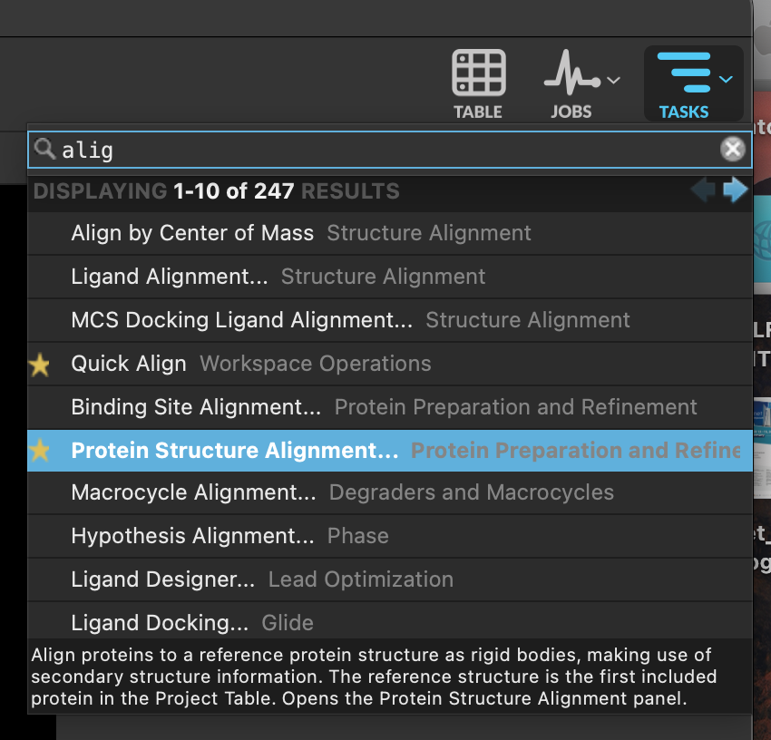
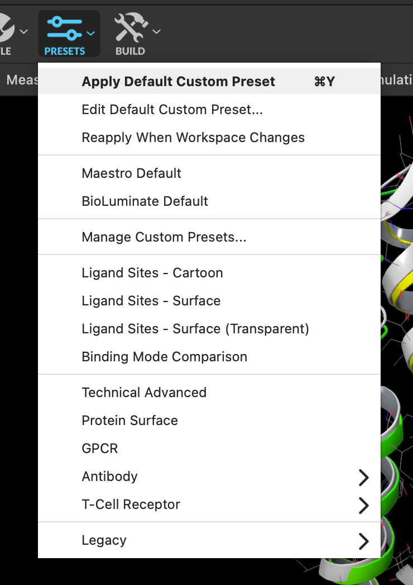

# 06 · Align the receptors

**Goal:** put both pockets in the same frame of reference so that differences you see are real.

Two structures solved in different labs sit at arbitrary positions in space. Until you align them, any comparison you make is about where the coordinates happen to be.

1. Include **both** prepared structures.
2. In **TASKS**, open **Protein Structure Alignment**.

3. Set the reference residues to `res.sec helix` and click **Align**.

This aligns on secondary structure — the seven transmembrane helices — rather than on sequence. 5-HT2A and 5-HT2B have different loops and different lengths, but the helical bundle is the shared scaffold.

4. Apply your default **PRESETS** to both so they are drawn the same way.

> **Discuss** — now that the bundles overlap, look at the two LSD molecules. Do they sit in the same place and the same orientation? If they differ, is that a real difference between the receptors, or an artefact of how you aligned?
> {: .discuss }

**Checkpoint**

- [ ] The two helical bundles overlap.
- [ ] Both LSD molecules are in roughly the same region of space.
- [ ] Both structures are drawn with the same preset.

[Previous](05-Prepare-proteins.md) · [Workshop home](index.md) · [Next: compare the two pockets](07-Compare-interactions.md)
