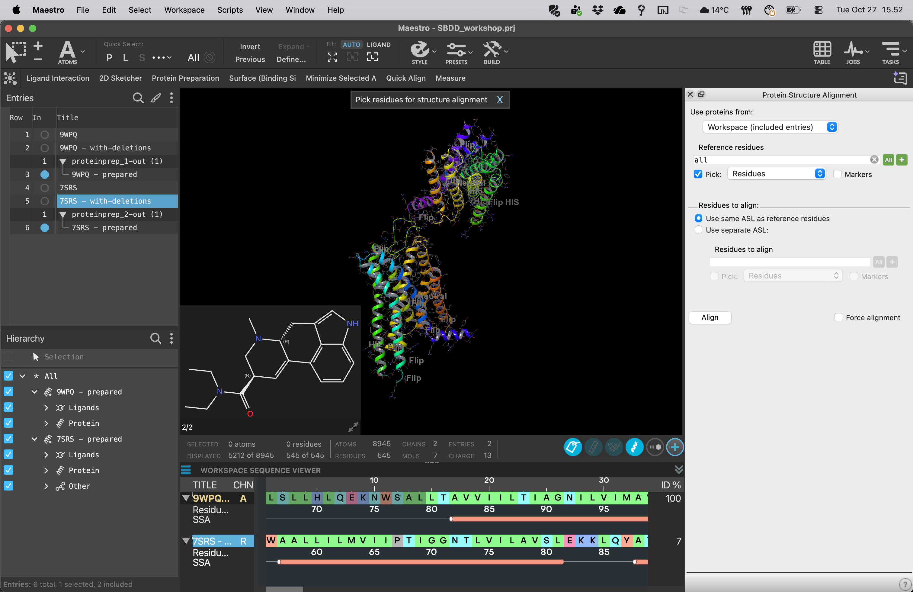
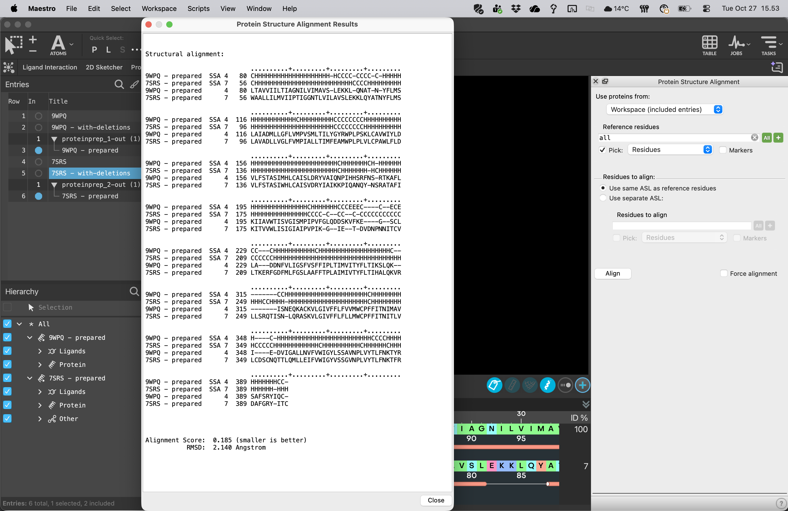

# 06 · Align the receptors

**Goal:** compare corresponding pockets in a shared coordinate frame.

1. Include only the two cleaned receptor–LSD entries. Give the receptor carbons different colors.
2. Search **TASKS** for **Protein Structure Alignment**.
3. Choose 5-HT2A as the reference and 5-HT2B as the mobile structure. Use the cleaned receptor proteins as the alignment input.
4. Align corresponding backbone / Cα atoms in the transmembrane core. Inspect the sequence alignment; omit long unmatched terminal or loop regions from the fit if they distort the core comparison.
5. Apply the transform to the **whole mobile complex**, including LSD. Do not independently align the ligands: their relative poses are part of the comparison.
6. Review the alignment results, record RMSD and the number or coverage of matched residues, and inspect the pocket visually.

A low RMSD over a short fragment does not establish a good receptor-wide alignment. Check that the seven-helix cores overlap, that corresponding pocket residues map sensibly, and that both LSD molecules remain in their own pockets. Flexible loops may disagree even when the core fit is useful.

**If the fit looks wrong:** check that the selected chains are receptors, inspect the sequence correspondence, and restrict the fit to the conserved helical core. Ask an instructor before continuing with a visibly mismatched pocket.

Save the aligned cleaned entries. Preparation may make small coordinate adjustments; check the overlay again after step 07. Any later coordinate transform must move the receptor and its bound reference ligand together. Generate grids only after the final coordinates are settled.

**Checkpoint:** a shared pocket view and a recorded assessment of the fit, with both ligands retained.

[Previous](05-Remove-unwanted-chains.md) · [Home](index.md) · [Next: prepare proteins](07-Prepare-proteins.md)
