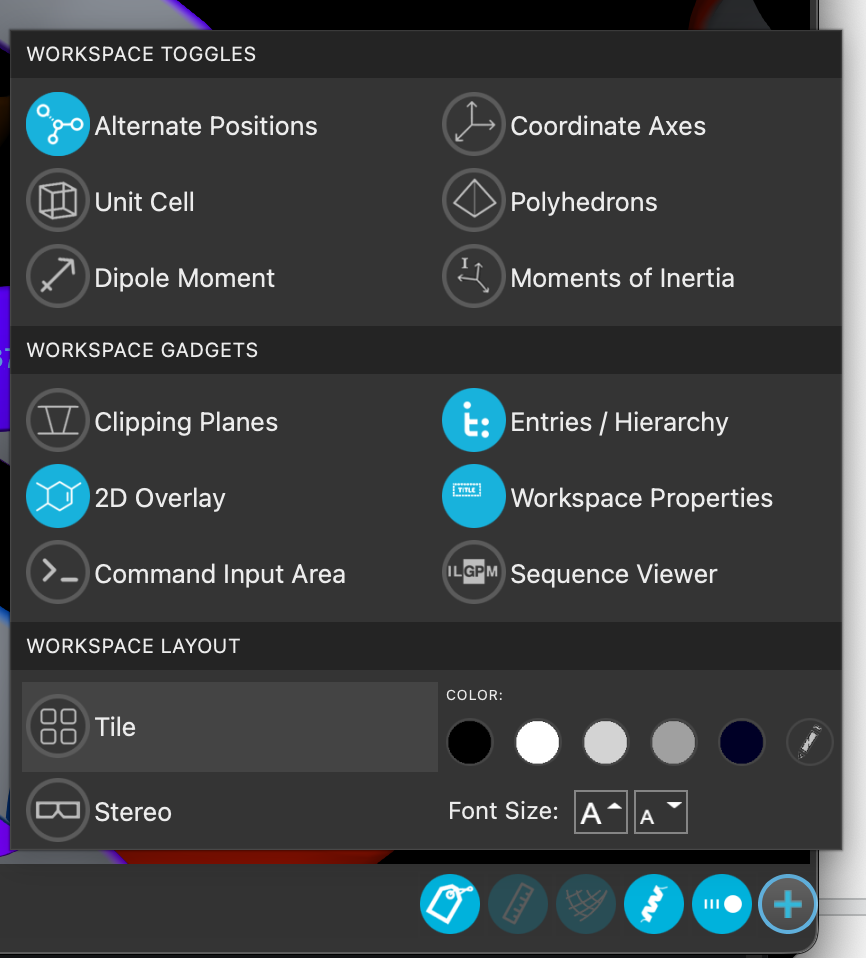
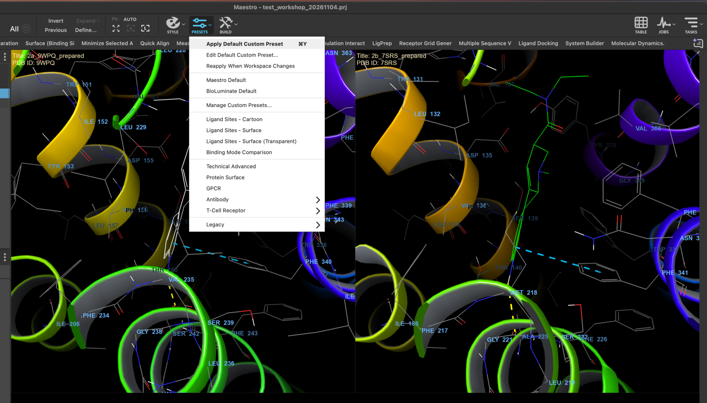
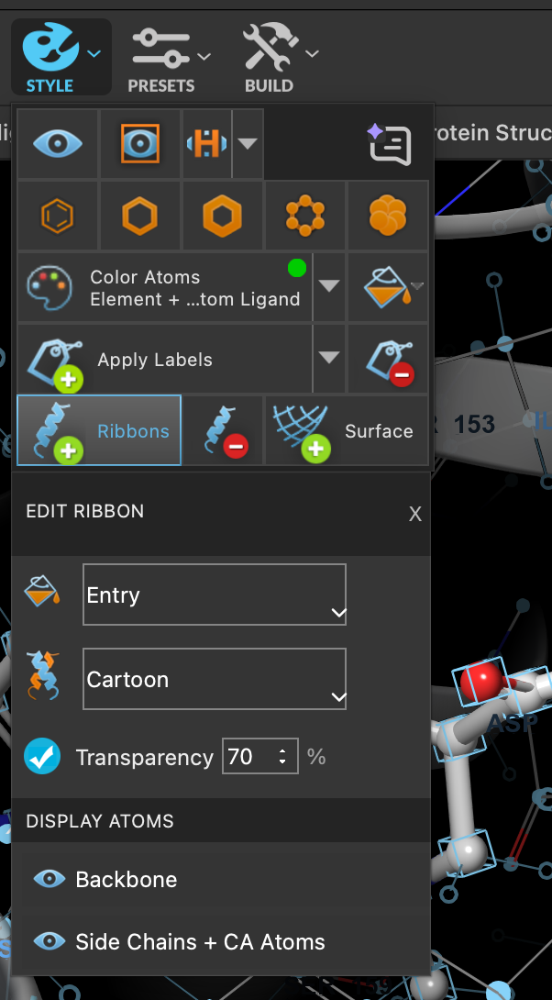
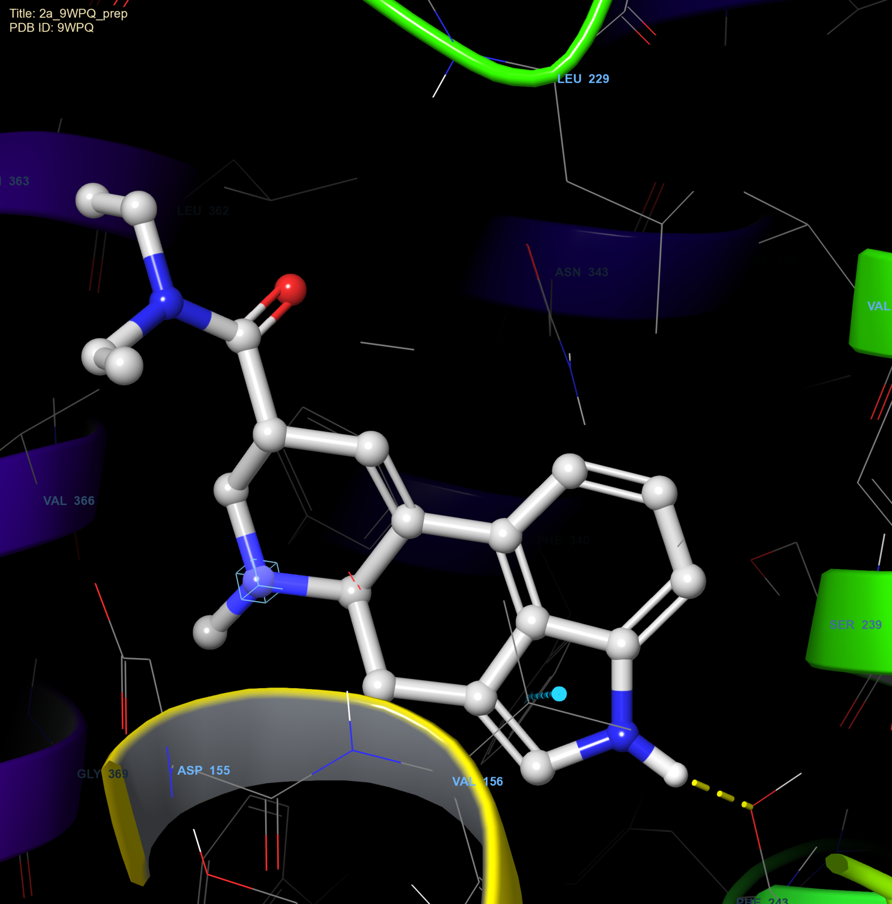
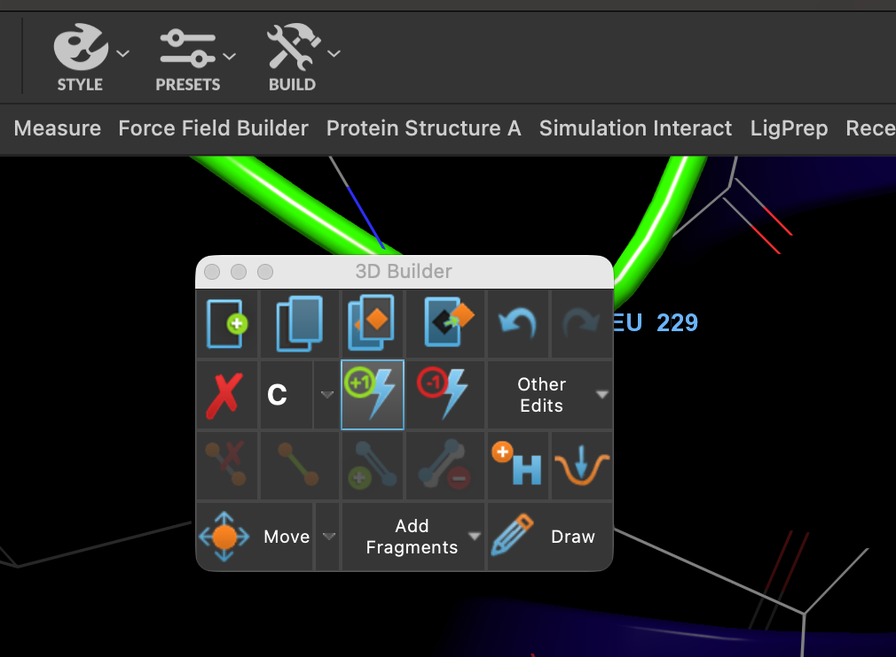
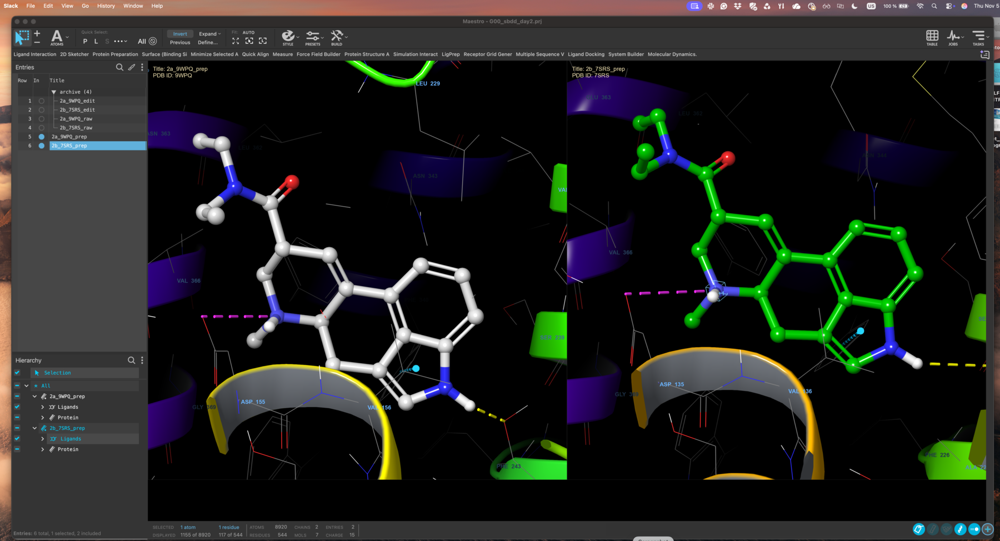
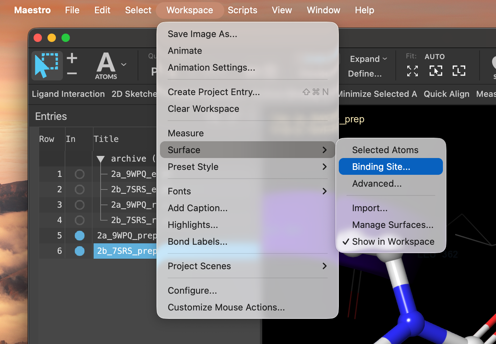
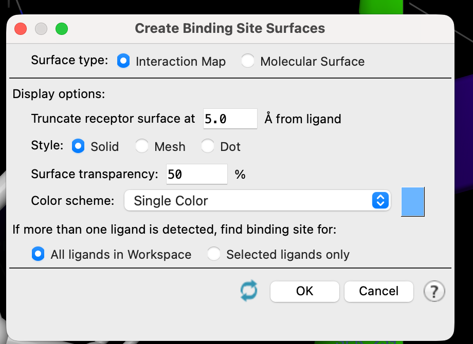
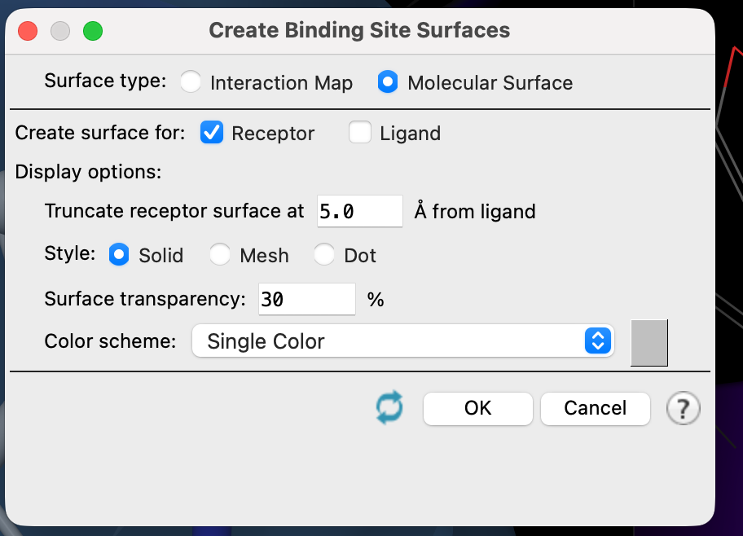
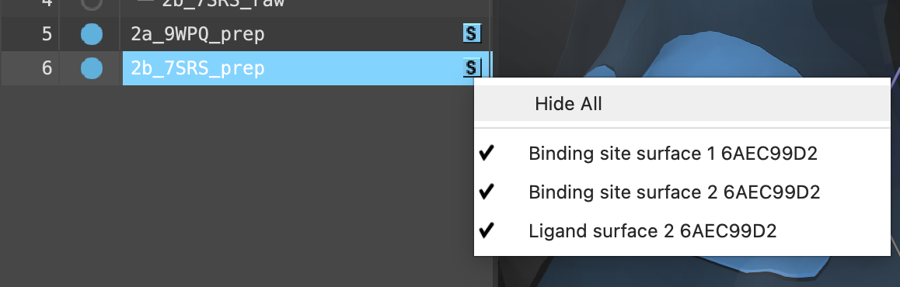

# 07 · Compare the two pockets

**Goal:** see exactly where 5-HT2A and 5-HT2B differ. Everything you design depends on this step.

## Get both on screen at once

1. Click the **+** in the corner of the Workspace and turn on **Tile**.

2. Hold `Ctrl`/`Cmd` to include the second structure, so both are shown side by side.

3. Apply your presets again if the view has drifted.

4. Optional, but it helps: make the cartoon slightly transparent so you can see the ligand through it.

## Fix the ergoline charge

LSD's ergoline nitrogen should be protonated and positively charged at physiological pH — that charge makes the salt bridge to the conserved aspartate in TM3, which is the anchor point for essentially every aminergic GPCR ligand.

5. If that nitrogen has no positive charge, click on it, then use **BUILD → +1** to add one.

A pink salt-bridge interaction should appear. Repeat in the other receptor.

## Look at the pocket

6. Go to **Workspace → Surface → Binding site**.

7. Choose the **interaction map** to colour the surface by what the pocket offers chemically.

8. Try it again with a **molecular surface** — and remember to uncheck **Ligand**, or you will be looking at a surface wrapped around LSD instead of the pocket.

9. The **S** button next to an entry toggles protein and ligand visibility quickly.

> **Discuss** — this is the step that decides your designs, so take your time with it.
> {: .discuss }
>
> - Which LSD contacts are present in **both** receptors? Those are the ones you probably want to keep.
> - Where does the pocket have room in 2A that it does not have in 2B, or the other way round?
> - Find at least one position where the two receptors present a **different residue**. Is the difference in the side chain itself, or only in the conformation it has taken?
> - If you wanted to lose 2B binding without losing 2A, which part of the molecule would you change?

**Checkpoint**

- [ ] Both pockets are visible side by side, drawn the same way.
- [ ] The ergoline nitrogen carries a positive charge in both, with a salt bridge shown.
- [ ] You have looked at both an interaction map and a molecular surface.
- [ ] Your group can name at least one concrete difference between the two pockets.

[Previous](06-Align-receptors.md) · [Workshop home](index.md) · [Next: form your hypotheses](08-Form-design-hypotheses.md)
