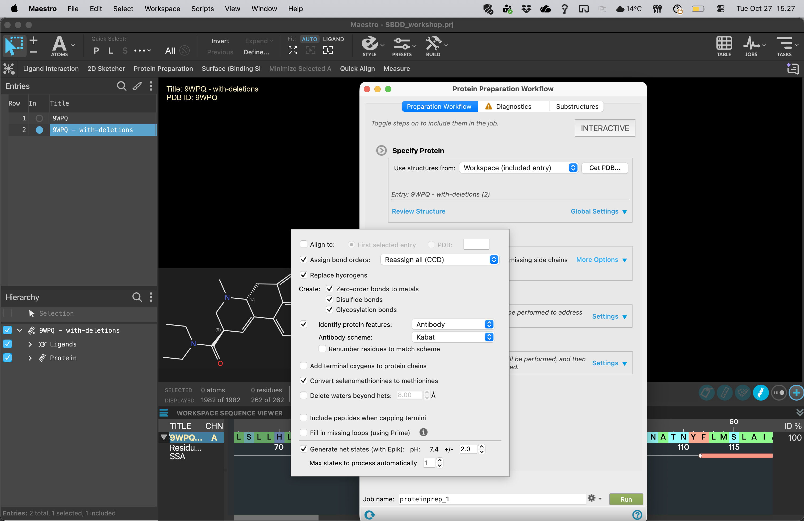

# 07 · Prepare the proteins

**Goal:** obtain checked receptor models with consistent chemical assignments.

Use the shared workshop protocol below unless the instructor announces a revised setting for everyone. Record the actual software release, force field and settings in your worksheet.

| Setting | Workshop starting protocol |
| --- | --- |
| Input | One cleaned, aligned receptor–LSD complex at a time |
| Preprocess | Assign bond orders; add hydrogens; build disulfides; fill missing side chains |
| Missing loops | No automatic long-loop rebuilding; resolve pocket-adjacent gaps with the instructor |
| Protein protonation / H-bond optimization | Target pH **7.4**; inspect titratable pocket residues |
| Ligand state generation, where offered | Epik at **pH 7.4 ± 1.0** |
| Waters | No explicit waters in the common baseline, consistently for both receptors |
| Force field | **OPLS4**, if available; otherwise the single course-wide alternative |
| Refinement | Restrained minimization, **0.3 Å heavy-atom RMSD convergence setting** where offered |

The workflow combines chemical preprocessing, hydrogen-bond assignment and restrained refinement. See the [official preparation overview](https://www.schrodinger.com/life-science/learn/white-papers/protein-preparation-workflow/) and [docking lesson](https://www.schrodinger.com/wp-content/uploads/2023/11/gb-docking-ls.pdf) for the purpose of these stages. The table specifies the teaching protocol, which the instructor must rehearse on the installed release.

1. Include only `2A_9WPQ_clean`, open **Protein Preparation Workflow**, and confirm the input entry.
2. Open **Preprocess → More Options**. Review each enabled operation using the table. Keep LSD so the bound complex is prepared in context.
3. Enable the H-bond optimization and restrained minimization stages. Set the pH and force field consistently. Review any termini-capping choice with the instructor, especially at chain breaks near the pocket.
4. Name the job `G04_2A_prep`, select the course job host, and **Run**. Monitor **JOBS** and incorporate the output.
5. Repeat for `2B_7SRS_clean` using the same protocol.
6. Rename the outputs `2A_9WPQ_prepared` and `2B_7SRS_prepared`. Exclude earlier entries; retain them in the project.
7. Reopen diagnostics on the outputs. Inspect LSD bond orders, stereochemistry and charge, the nearby acidic anchor residue, added side chains and any remaining severe clashes.
8. Compare prepared and input pockets, and check the receptor overlay. Investigate large unexpected changes before making grids.

Removing waters is a simplifying model choice, not evidence that water-mediated contacts are unimportant. Restrained minimization refines the input model; it does not establish a uniquely correct binding-site conformation.

**Checkpoint:** two successful prepared outputs, checked diagnostics and saved settings. If a run fails or changes the pocket unexpectedly, use the instructor's matching checkpoint files.

[Previous](06-Align-receptors.md) · [Home](index.md) · [Next: interactions and surfaces](08-Inspect-interactions.md)
