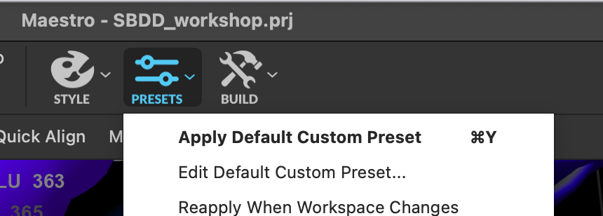
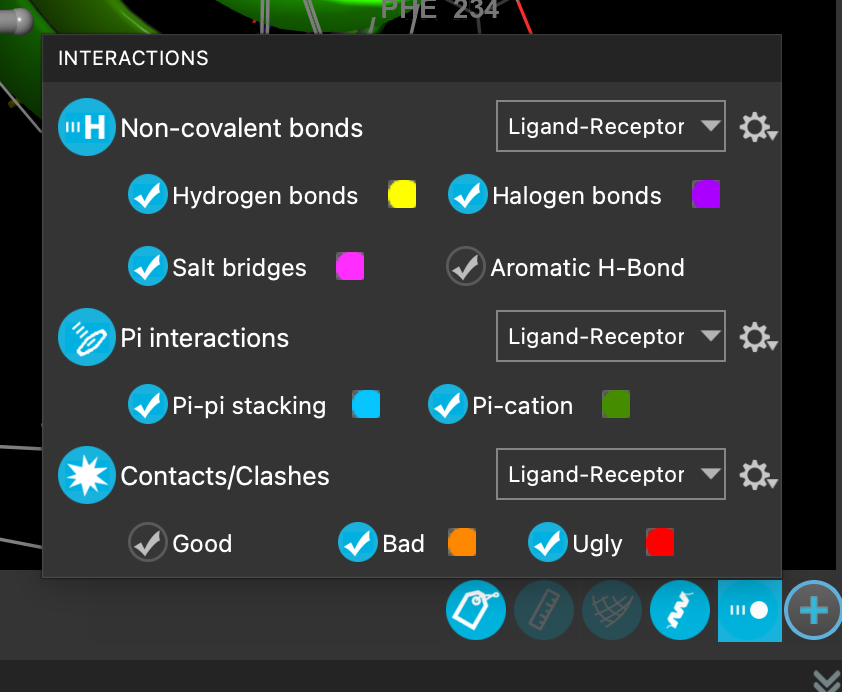
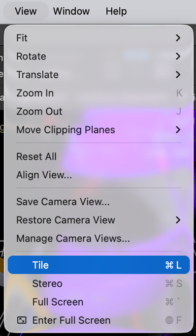
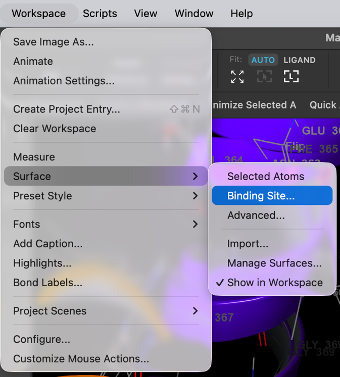
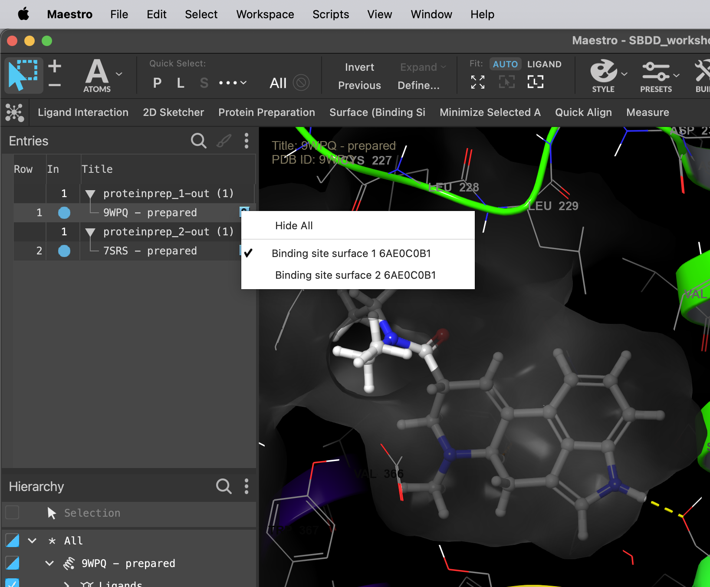

# 08 · Compare ligand interactions and binding-site surfaces

**Goal:** relate LSD chemistry to the shape and chemical features of both pockets.

1. Include the prepared 5-HT2A complex alone. Select LSD and fit the view to it.
2. Use **PRESETS → Apply Default Custom Preset** if configured for the course. Otherwise display LSD and nearby residues as sticks, keep receptor ribbons, and enable ligand–receptor interactions.
3. Open the interaction display options. Enable the categories you want to inspect: hydrogen bonds, salt bridges, π interactions and contacts/clashes. Check the legend and geometry rather than counting every dashed line as a favorable interaction.
4. Inspect the protonatable amine, indole region and amide region of LSD. Record nearby residues using the numbering actually shown in your structure.
5. Use **Workspace → Surface → Binding Site** (or the corresponding **Surface (Binding Site)** tool). Select LSD to define the site and create a surface for **protein atoms only**.
6. Adjust transparency, clipping or visibility so that the ligand remains visible. If both receptor surfaces obscure each other, hide one surface using the surface manager / visibility menu.
7. Repeat for 5-HT2B with the same contact-display settings and site definition.
8. Include both aligned complexes and use **View → Tile** for separate side-by-side views. Also inspect the overlay to compare corresponding positions. Match orientation and scale before comparing cavity shapes.

Look for a conserved anchoring interaction, buried versus solvent-exposed ligand regions, and a cavity or contact that differs between receptors. A geometrical surface shows shape; do not interpret its colors as electrostatic potential unless an electrostatic property has actually been calculated and mapped with a legend.

| Observation to record | Evidence to capture |
| --- | --- |
| A likely ionic or hydrogen-bond interaction | Ligand atom, residue, distance and plausible protonation |
| A hydrophobic or aromatic contact | Contacting groups and local packing |
| A possible modification direction | Available space and nearby polar/nonpolar features |
| A subtype difference | Corresponding residue pair or pocket region in both structures |

**Checkpoint:** save one matched pocket view per receptor and at least three observations. Include one similarity and one candidate difference.

[Previous](07-Prepare-proteins.md) · [Home](index.md) · [Next: design hypotheses](09-Form-design-hypotheses.md)
