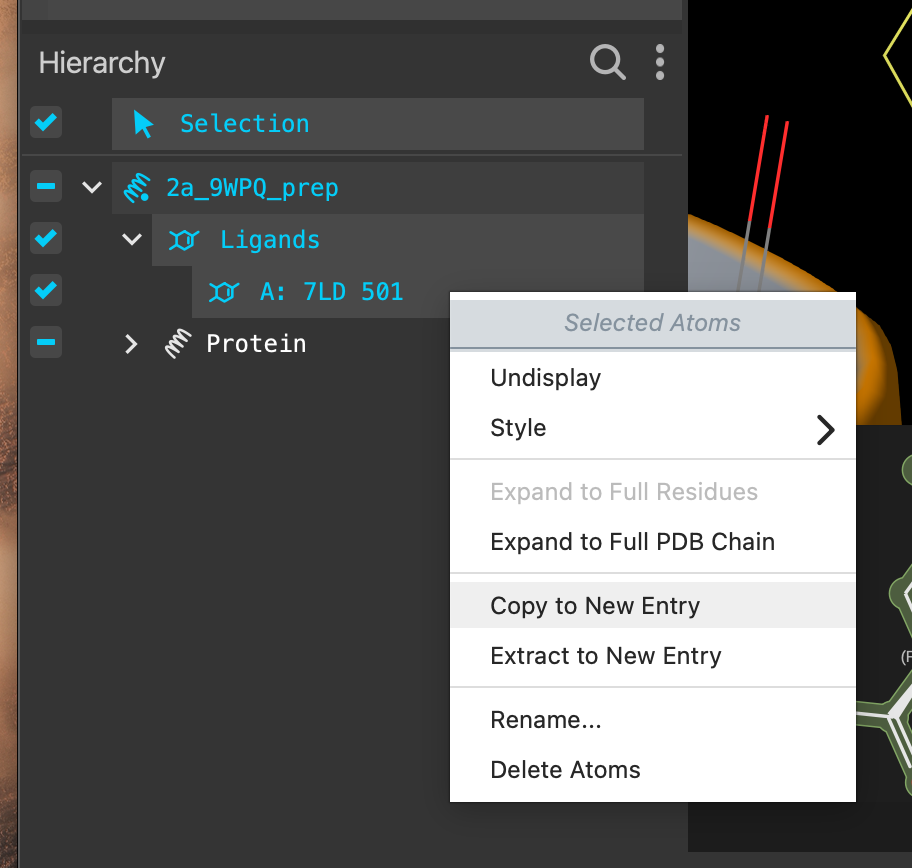
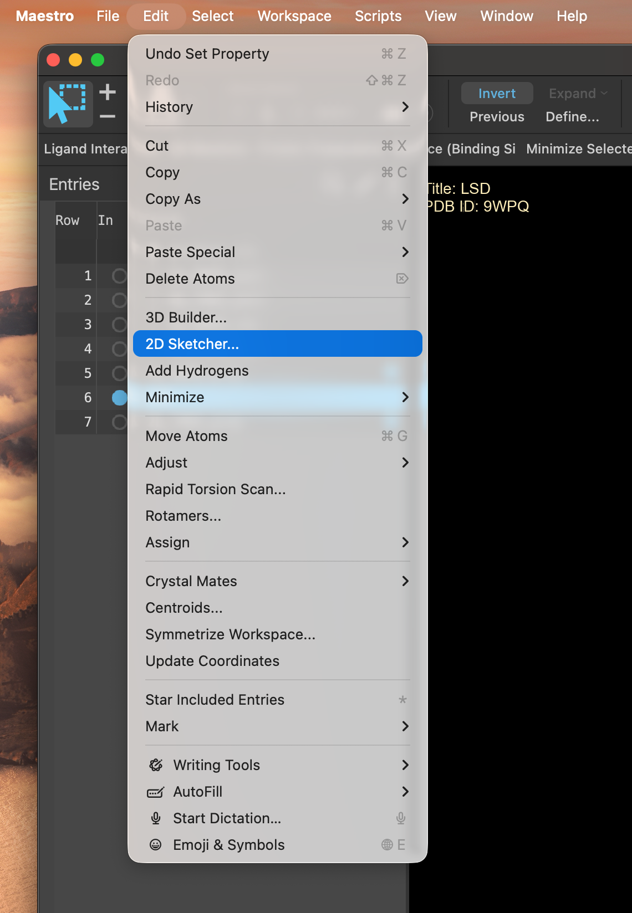
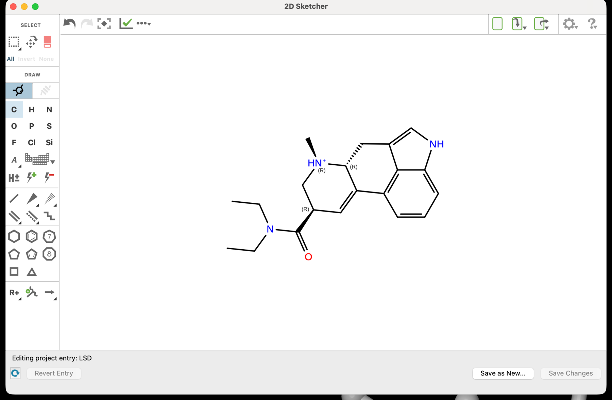
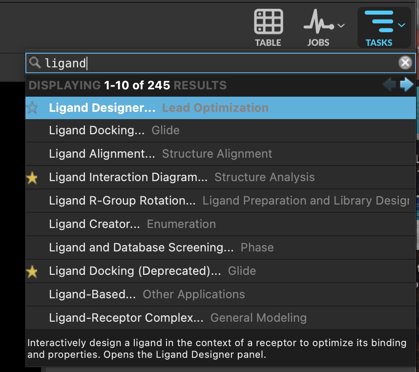
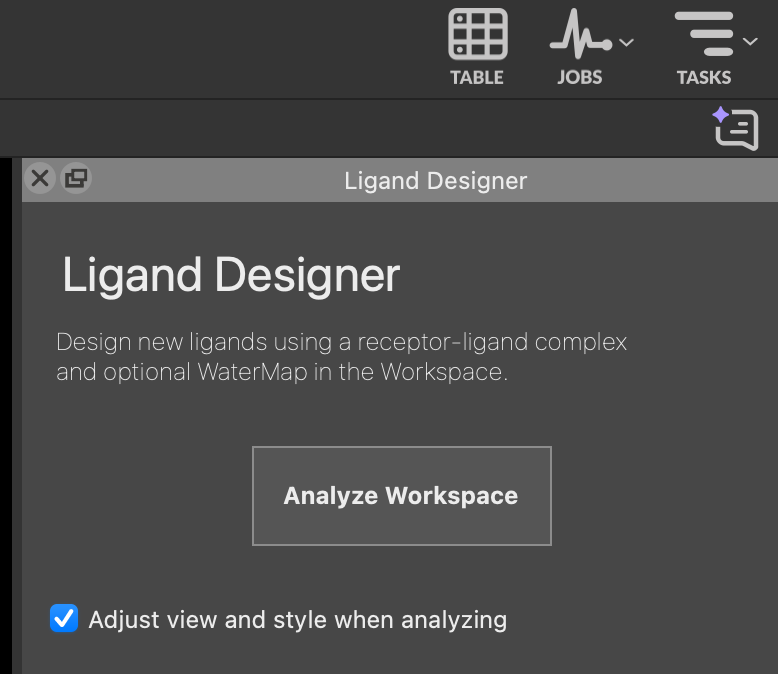
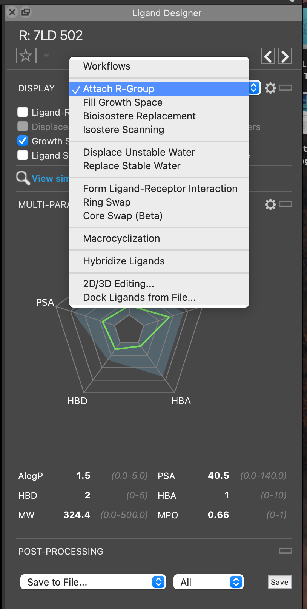
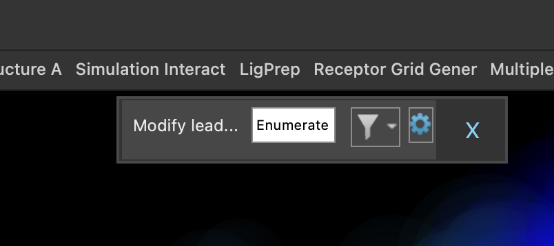
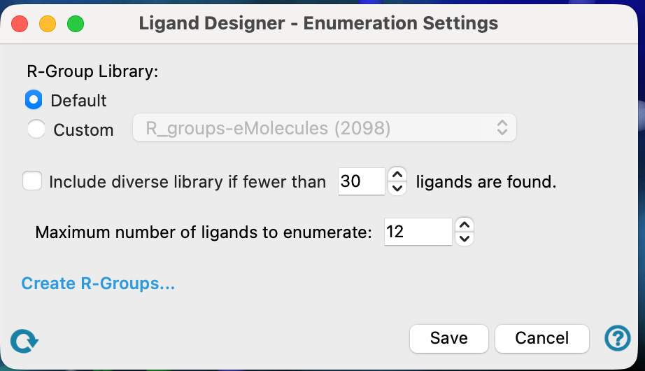
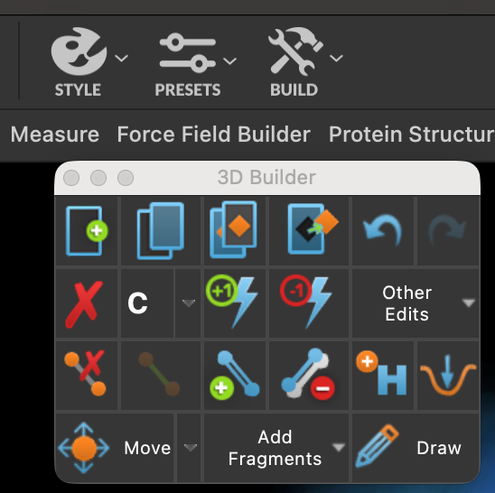
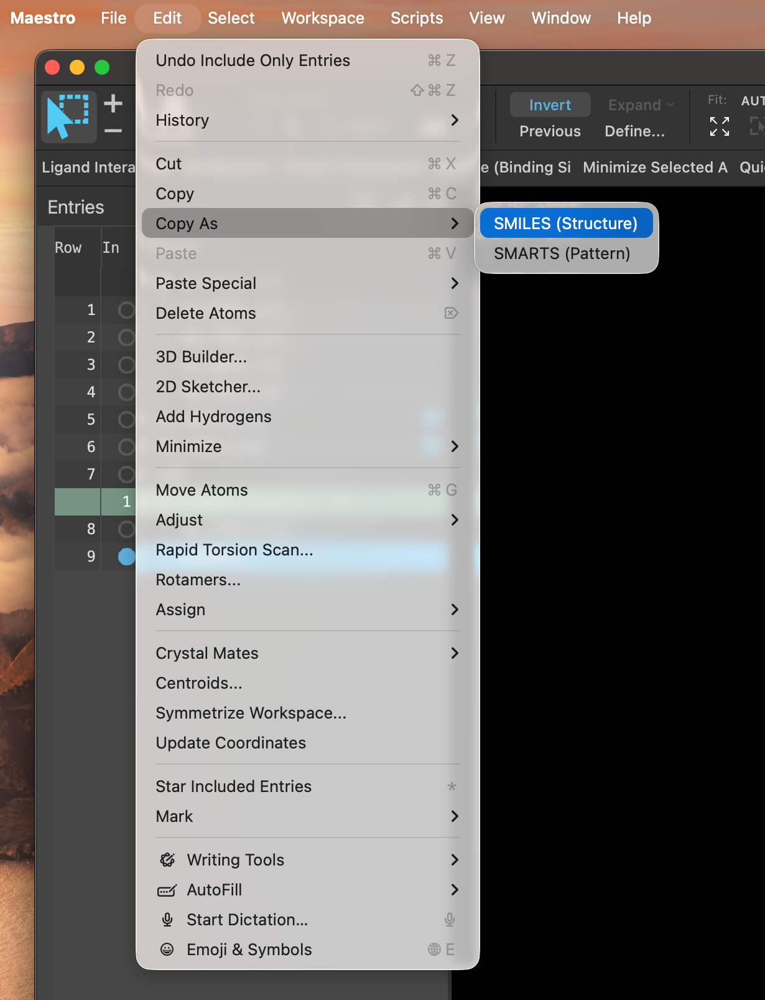

# 09 · Draw your candidates

**Goal:** turn each hypothesis into an actual molecule.

Two routes. Route A edits LSD directly and is the quickest way to make a small, deliberate change. Route B uses Ligand Designer to enumerate variations around a position. Use whichever suits your idea — or both.

## Route A · Edit LSD directly

1. Include one of your **prepared** complexes. In the **Hierarchy**, select the ligand — its residue code in these structures is **7LD** — and copy it into a new entry. Take it from the prepared structure, not the raw one, so that the ergoline charge you checked in step 07 comes with it.

2. Rename the new entry **`LSD`**. This is your docking control and every score today is read against it, so leave it unmodified from here on.

3. Make your change, then use **Save as New** so the original survives.

## Route B · Ligand Designer

4. In **TASKS**, open **Ligand Designer**.

5. Click **Analyze Workspace**. It reads the pocket around your ligand and tells you what is available where.

6. Explore the **Display** options to see what the pocket offers.

7. To grow a substituent, use **Attach R-group**. Open the settings with the gear icon.

8. Pick a **modest** number of R-groups and click **Enumerate**. Asking for hundreds will not help you choose and will slow everything down.

9. Alternatively, use **Build** to add atoms, bonds and groups by hand.

## Get the SMILES out

10. Select your finished molecule, then **Edit → Copy as SMILES**.

Paste it somewhere safe. You will need it in step 12.

> **Discuss** — look at what you drew, not at what you meant to draw. Did the ergoline nitrogen keep its charge? Are the stereocentres still the ones LSD has? Has the ring system survived intact? Hand your molecule to someone else in the group and have them find the mistake.
> {: .discuss }

**Checkpoint**

- [ ] You have an unmodified `LSD` entry to use as the control.
- [ ] Each participant has at least one candidate molecule.
- [ ] Every candidate's SMILES is saved somewhere you can paste from.
- [ ] Someone other than the author has checked each structure.

[Previous](08-Form-design-hypotheses.md) · [Workshop home](index.md) · [Next: choose the human designs](10-Choose-human-designs.md)
