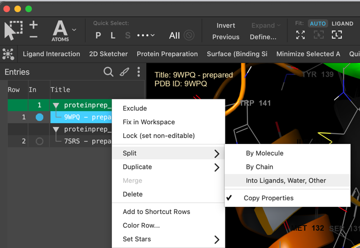
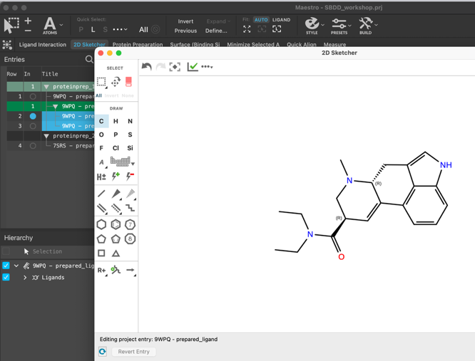
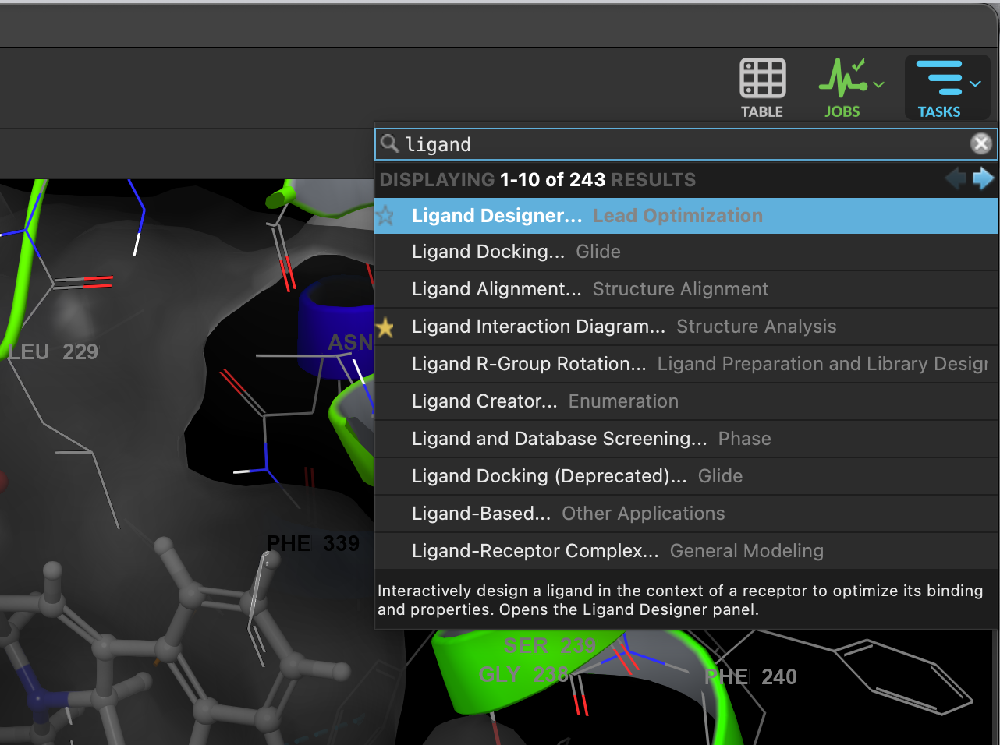

# 10 · Draw candidate molecules

**Goal:** turn your structural hypotheses into explicit chemical structures.

Keep the prepared receptor–LSD complexes intact. Draw on a duplicate ligand entry and retain the reference LSD structure for grid generation and pose comparison.

## Route A: 2D Sketcher

1. Duplicate a prepared complex. On the duplicate, use the entry context menu **Split → Into Ligands, Water, Other**, or **Split → By Molecule**, to obtain a separate LSD entry. Confirm which fragment is LSD.
2. Select the ligand entry and open **2D Sketcher**.
3. Modify the intended atoms or substituents. Check ring bonds, aromaticity, valence, formal charge and every stereocenter.
4. Apply the edit to the candidate entry or create a new entry, according to your release. Rename it with a temporary local ID such as `G04_H_A`.
5. Use the sketcher's SMILES export/copy control, if present, or export the selected ligand entry in **SMILES** format through **File → Export Structures**. Request isomeric SMILES so stereochemistry is retained.

## Route B: Ligand Designer

1. Include a duplicate prepared complex and search **TASKS → Ligand Designer**.
2. Specify its receptor and LSD ligand as requested by the panel.
3. Make your intended modification while inspecting the pocket, then save the resulting candidate as a separate ligand entry.
4. Inspect its 2D chemistry and export isomeric SMILES as above. Any score shown during editing is provisional; the competition uses the common docking protocol later.

If Ligand Designer is unavailable, use 2D Sketcher. Both routes produce the same deliverable: an unambiguous molecular structure and its SMILES.

## Check the exported molecule

Paste the SMILES into the submission interface's preview without submitting yet. Compare the drawing with your intended structure, including stereochemistry. A parseable SMILES can still encode the wrong molecule. Preserve the parent scaffold's stereochemistry unless changing it is an explicit, justified design choice; do not let unspecified centers become accidental mixtures.

**Checkpoint:** candidate entries and SMILES encode the intended chemistry, and the original bound LSD remains available.

[Previous](09-Form-design-hypotheses.md) · [Home](index.md) · [Next: choose human designs](11-Choose-human-designs.md)
