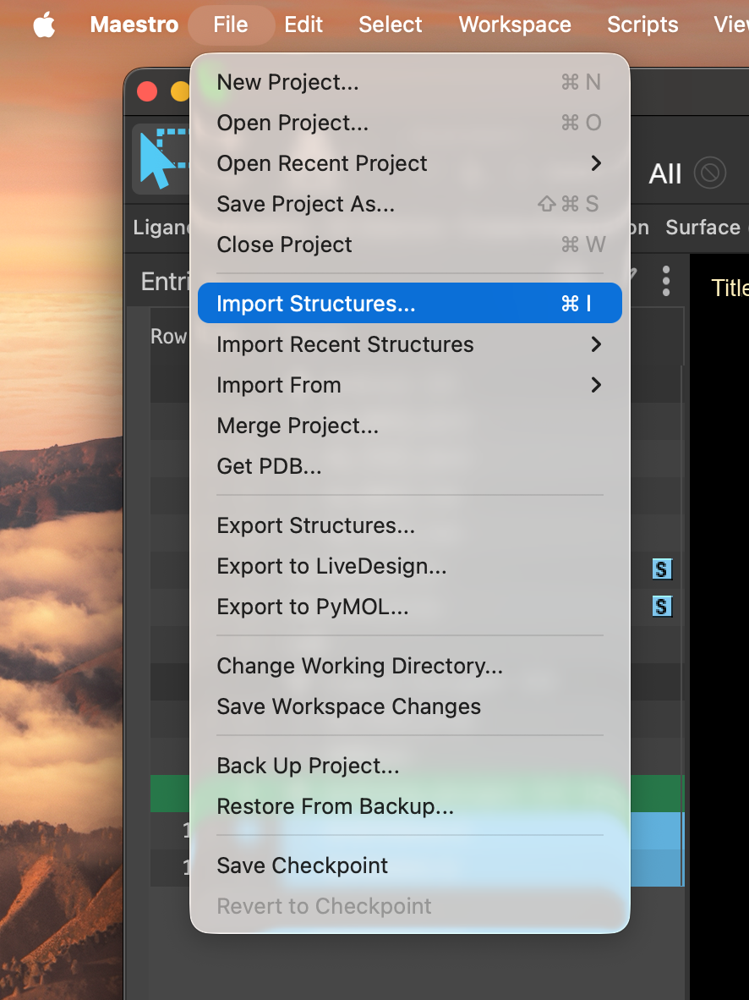
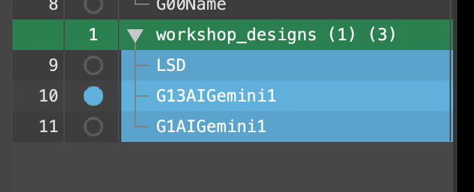
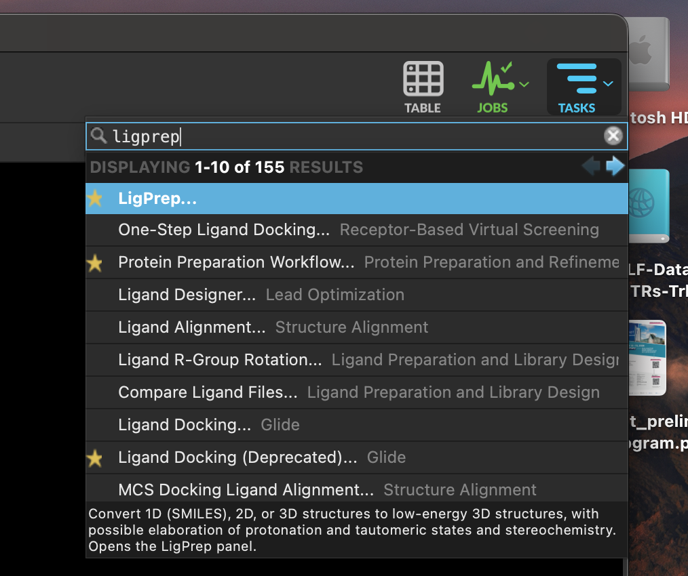
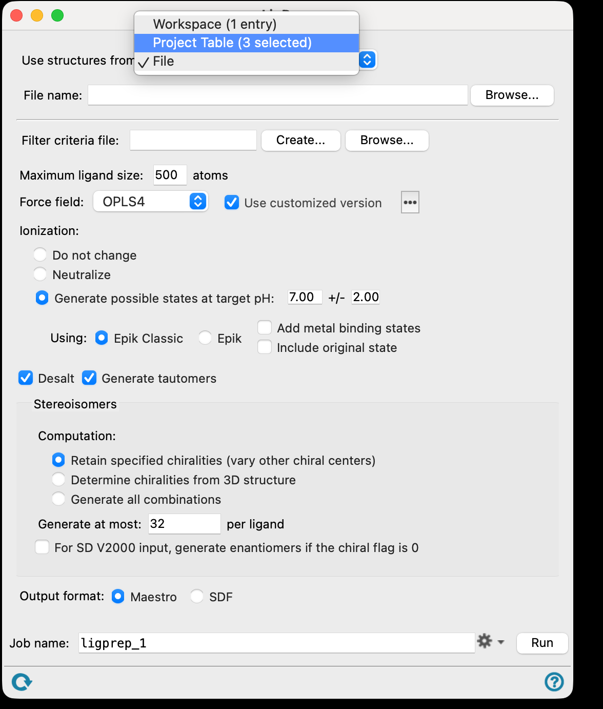
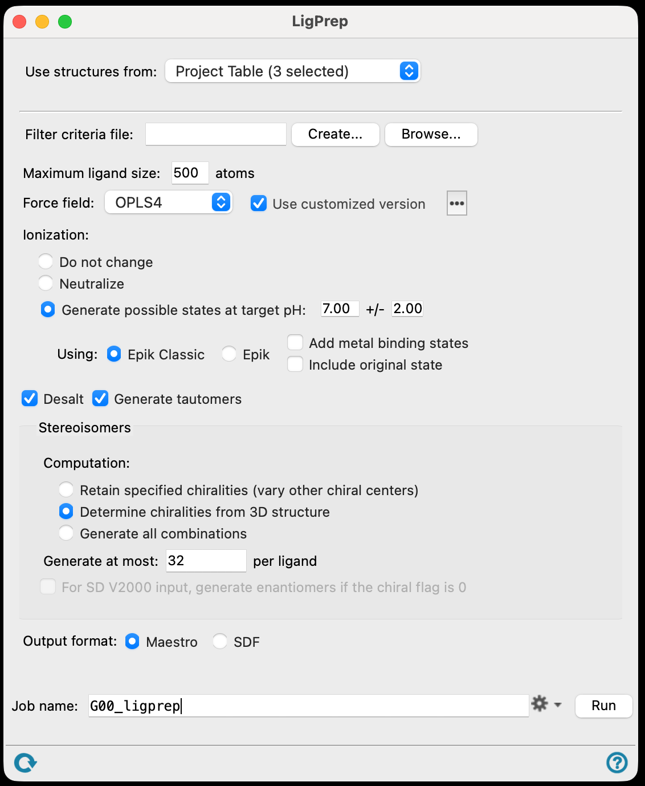

# 13 · Prepare the ligand library

**Goal:** turn SMILES strings into 3D structures with sensible protonation and stereochemistry.

A SMILES string has no coordinates, no hydrogens and no decision about what is charged. LigPrep makes all of those decisions for you — which is exactly why you should look at what it did.

## Import and cut down

1. **File → Import Structures**, find the `.smi` file from the instructors, and import everything.

2. Delete the other groups' ligands. Keep your six.
3. Move the **LSD** entry you copied in step 09 into the ligand list. This is your control: it is the molecule the structures were actually solved with, so it tells you whether the whole pipeline is behaving.

## Run LigPrep

4. Search **TASKS** for **LigPrep** and open the panel.

5. Use structures from the **Project Table**.

6. Tick **Determine chirality from 3D structure**, give the job a name, and **Run**.

## What LigPrep is deciding

| Setting | What it does | Why it matters |
| --- | --- | --- |
| **Ionisation / Epik at pH** | Generates protonation states around a target pH | Decides whether your ergoline nitrogen is charged — and that charge makes the salt bridge |
| **Generate tautomers** | Enumerates tautomeric forms | Changes which atoms can donate and accept |
| **Determine chirality from 3D structure** | Takes stereochemistry from the drawn coordinates rather than re-enumerating it | Keeps the stereochemistry you drew, instead of docking a mirror image you never designed |
| **Generate at most N per ligand** | Caps how many variants each input produces | One input molecule can become many entries; this is why your output is longer than your input |
| **Desalt / remove counterions** | Strips salts | Not relevant here, but it is why some libraries shrink |

> **Discuss** — LigPrep will hand back more structures than you gave it. Before you look: which of your molecules do you expect to produce several states, and why? What does it mean for the docking that you are about to dock several versions of "the same" molecule?
> {: .discuss }

7. When the results come back, **delete the states where the ergoline nitrogen is not protonated**. You established in step 07 that this nitrogen carries the charge that anchors the ligand. Docking the neutral form wastes time and muddies the comparison.

To find them, include the LigPrep output group and step through the states, looking at that nitrogen in each one: the protonated form is drawn with a **+** next to it. If your release shows a net-charge column in the Project Table, sort on it and the neutral states group together — ask the Maestro Assistant what the column is called in your version.

Keep a note of how many states each of your six compounds ended up with. A compound that produced four states is a compound whose protonation you were not sure about, and that uncertainty is still in the result at the end of the day.

**Checkpoint**

- [ ] Only your group's six compounds plus LSD are in the library.
- [ ] LigPrep finished and produced 3D structures.
- [ ] Unprotonated ergoline states have been removed.
- [ ] You know how many states each compound ended up with.

[Previous](12-Submit-designs.md) · [Workshop home](index.md) · [Next: generate the grids](14-Generate-grids.md)
