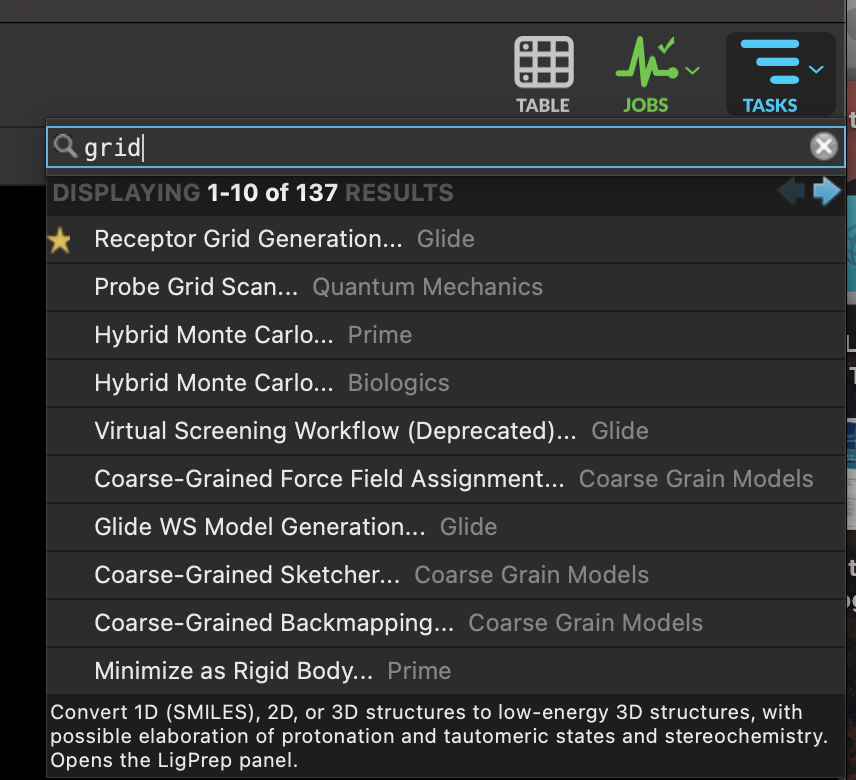
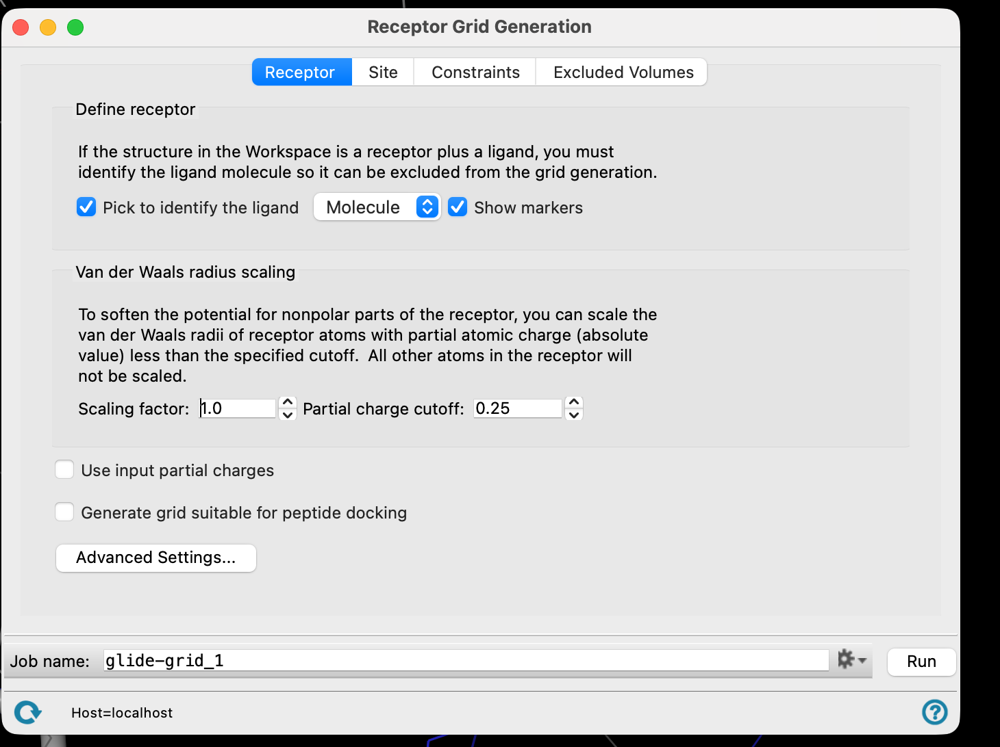
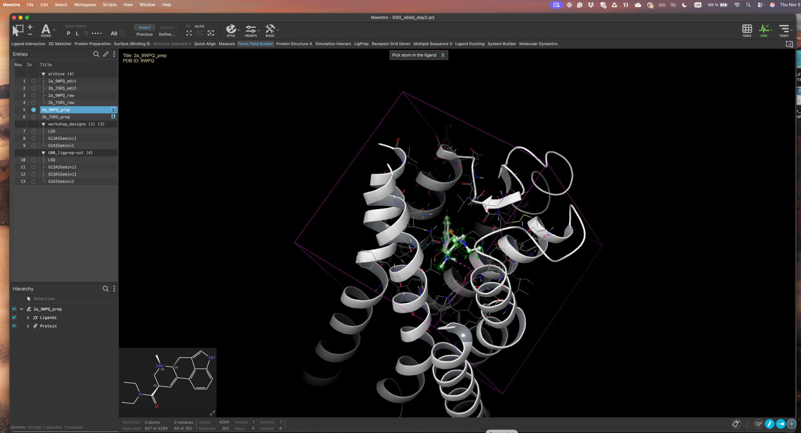
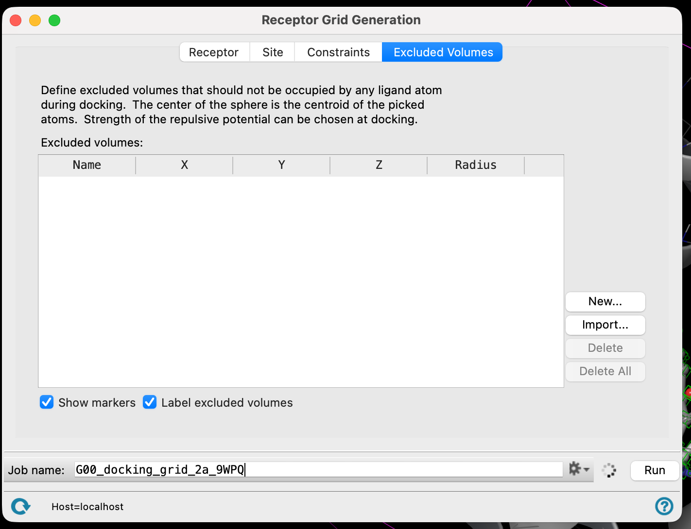
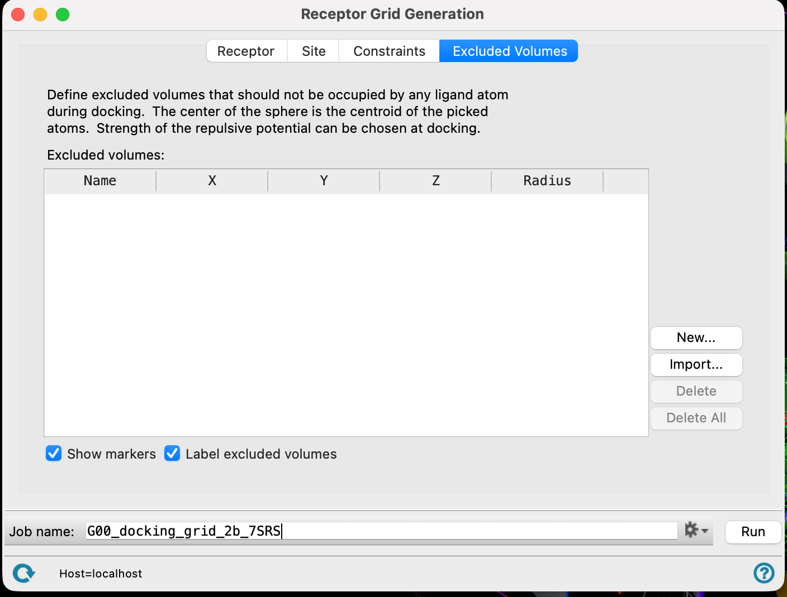

# 14 · Generate the receptor grids

**Goal:** one docking box per receptor, both centred on the LSD site.

A grid is a precomputed map of what the pocket offers at every point in a box. Glide searches inside that box and nowhere else — so the box defines the question you are asking.

1. Include the prepared **2A** complex.
2. In **TASKS**, open **Receptor Grid Generation**.

3. **Pick** the LSD molecule in the Workspace. Glide uses it to place the box.

4. A box appears around the ligand.

Leave the remaining settings at their defaults. Everyone using the same settings is what makes the group results comparable at the end of the day.

5. Name the job and **Run**.

6. Do the same for **2B**.

> **Discuss** — the box was placed using LSD. Your designs are bigger than LSD in places. What happens to a substituent that would like to reach outside the box? And since you built the two grids from two separately prepared structures, how comparable are the two scores you are about to get?
> {: .discuss }

**Checkpoint**

- [ ] One grid for 2A and one for 2B.
- [ ] Both are centred on the LSD site.
- [ ] Both used default box settings.
- [ ] You know where the two `.zip` grid files were written.

[Previous](13-Prepare-ligands.md) · [Workshop home](index.md) · [Next: dock to both receptors](15-Dock-to-both-receptors.md)
