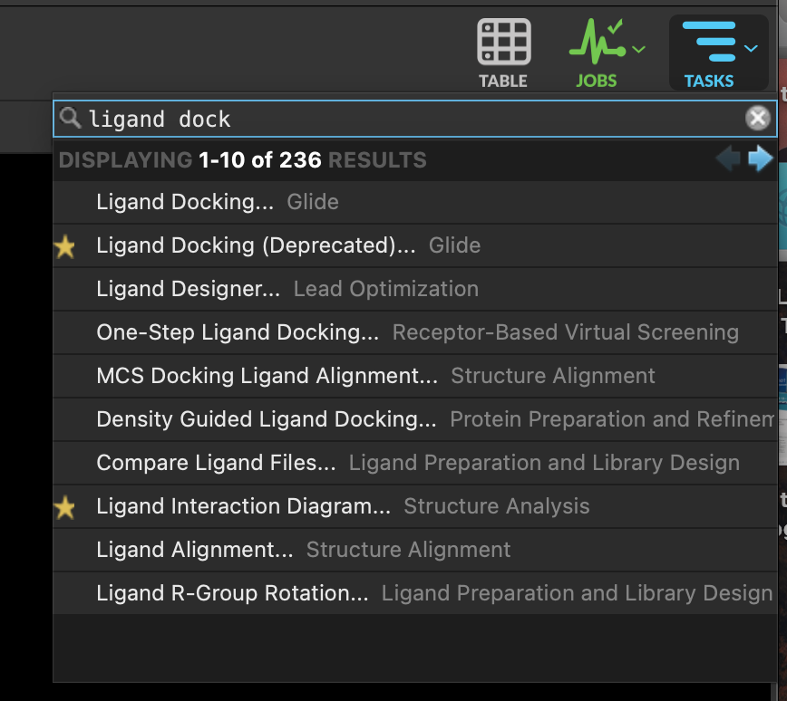
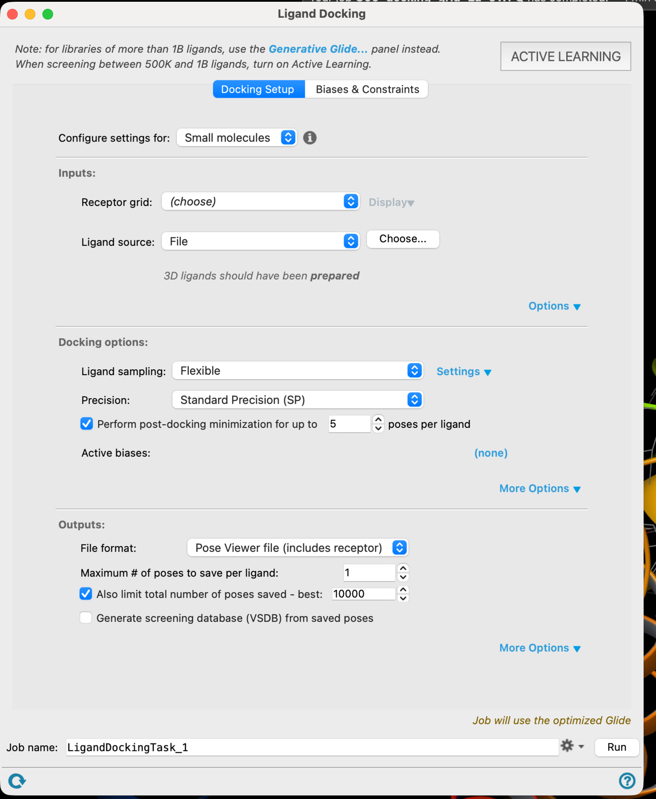
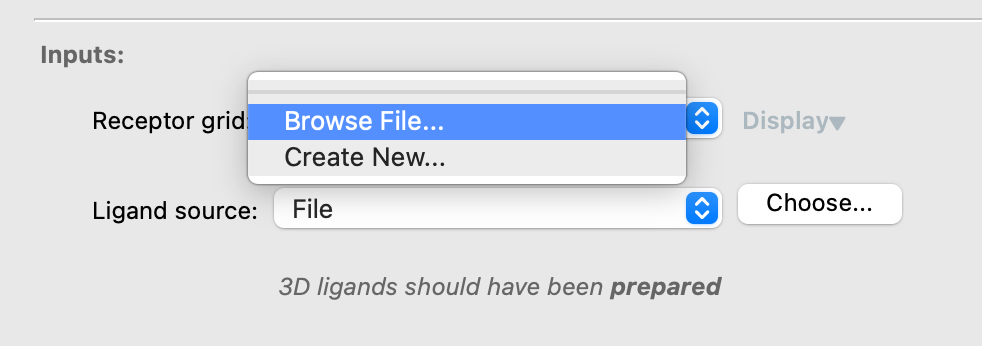
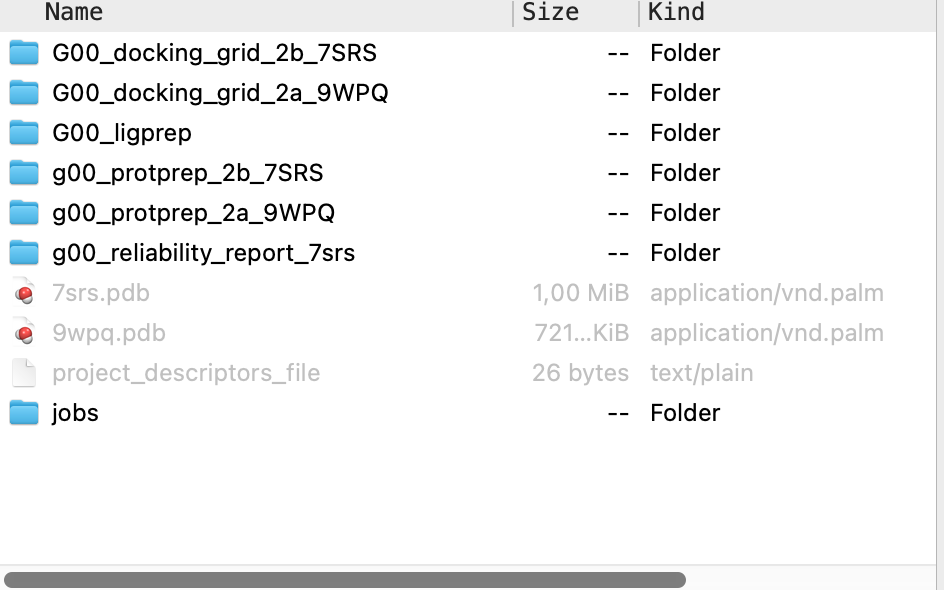
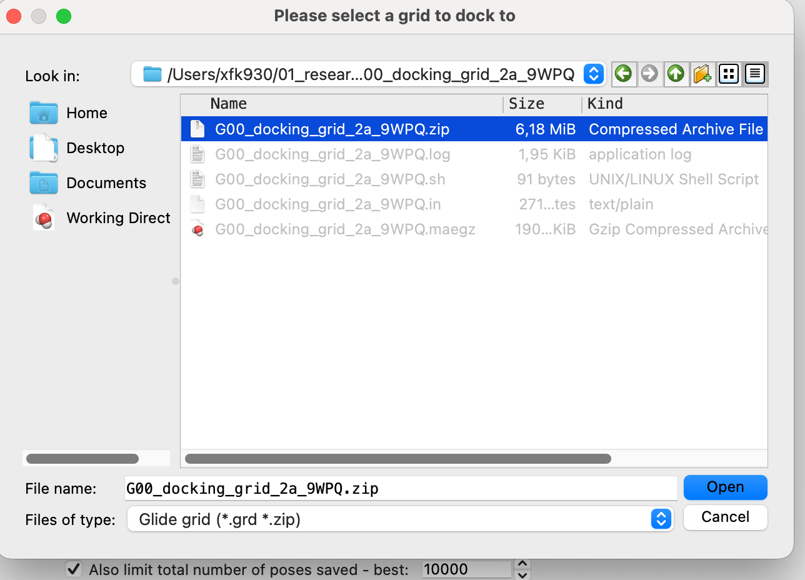
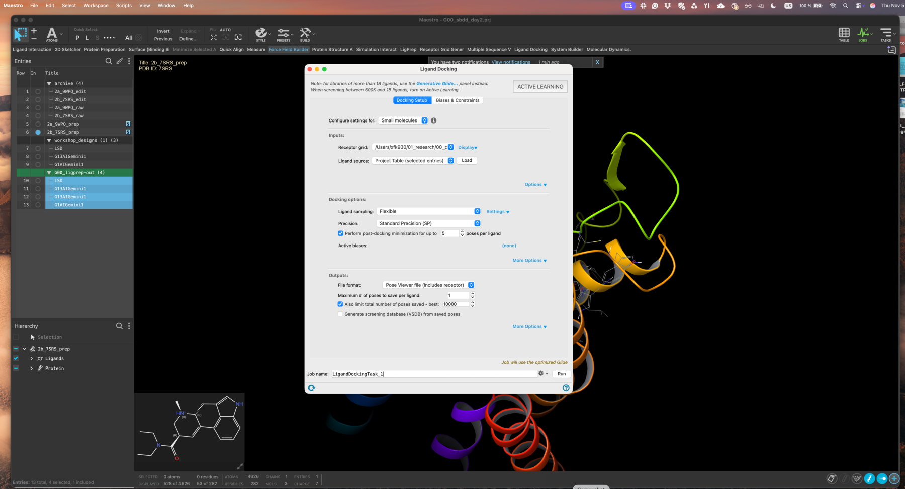
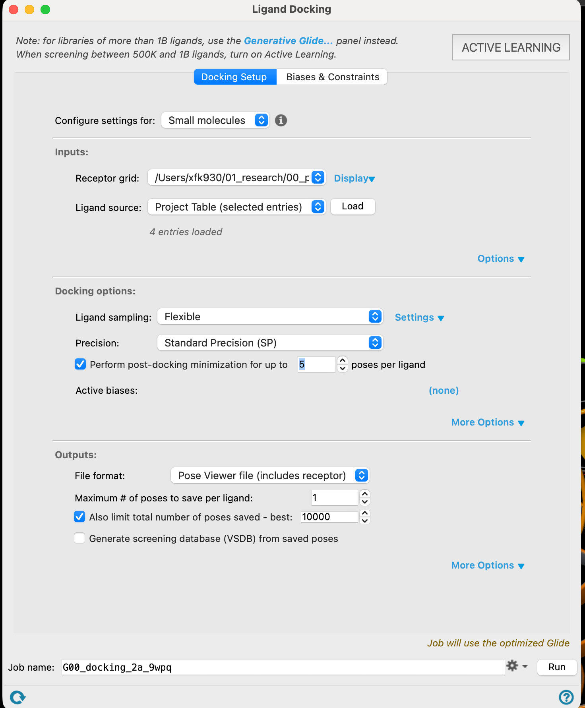
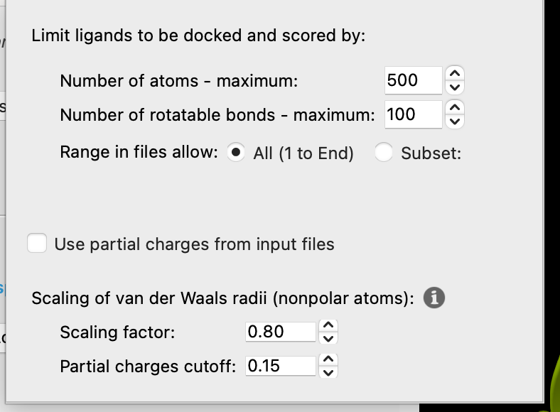
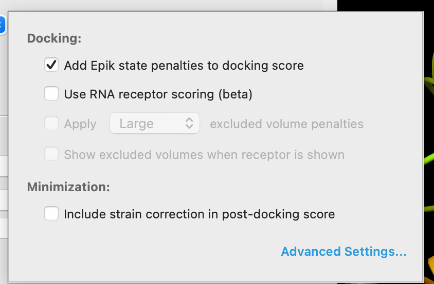
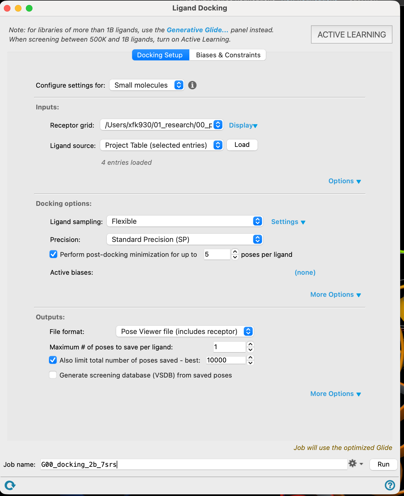

# 15 · Dock to both receptors

**Goal:** the same ligand library, docked twice. The comparison is the whole point.

## Set up the 2A run

1. In **TASKS**, open **Ligand Docking**.

2. Under **Grid**, choose **Browse file**.

3. Navigate to your 2A grid directory, select the `.zip` file and **Open**.

4. Select your prepared ligands in the Project Table. In **Ligand Source**, choose **Project Table (selected ligands)** and click **Load**.

5. Leave everything else at its default and **Run**.

## The settings worth knowing about

We will discuss these in class. You do not need to change them.

| Setting | What it does | Why you should know it exists |
| --- | --- | --- |
| **Precision (HTVS / SP / XP)** | How thoroughly Glide searches and rescores | SP is the workshop default. XP is slower and scores on a different scale — never compare an SP score with an XP score |
| **Scaling of van der Waals radii** (0.80) | Shrinks nonpolar ligand atoms | A softening fudge that lets ligands into slightly tight pockets. It is a modelling choice, not physics |
| **Partial charge cutoff** (0.15) | Which atoms count as nonpolar for that scaling | Changes which atoms get softened |
| **Add Epik state penalties** | Adds the energetic cost of forming a protonation state to the score | Stops a rare but well-fitting state from winning on geometry alone |
| **Max atoms / rotatable bonds** | Rejects ligands above the limit | Silently drops molecules. If a compound vanishes from your results, check here |
| **Include strain correction** | Penalises internally strained poses | Flexible ligands can otherwise score well in contorted conformations |
| **Write out N poses per ligand** | How many poses are kept | You only analyse the top pose, but the others tell you how confident the result is |

## Now do 2B

6. Go back to **Grid**, browse for the **2B** grid `.zip`, change the job name, and **Run**. The ligands are already loaded.

7. Close the docking panel and wait. Results appear in the Project Table as the jobs finish.

> **Discuss** — while the jobs run: your LSD control is in both runs. What score do you expect it to get, and what would it tell you if LSD scored badly in a structure that was *solved with LSD in it*?
> {: .discuss }

**Checkpoint**

- [ ] Two docking jobs, one per receptor, same ligands.
- [ ] Both finished and wrote results into the Project Table.
- [ ] The LSD control has a score in both.
- [ ] You can tell the two result sets apart by their job names.

[Previous](14-Generate-grids.md) · [Workshop home](index.md) · [Next: analyse the results](16-Analyse-selectivity.md)
