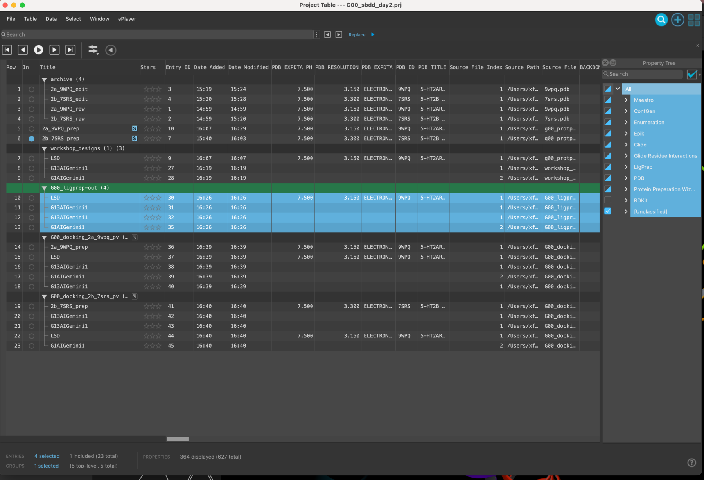
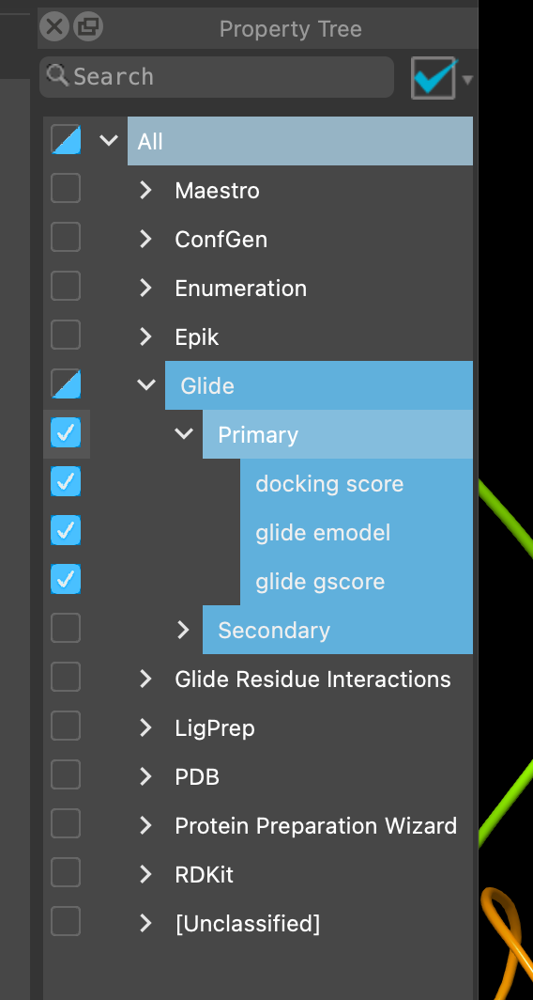
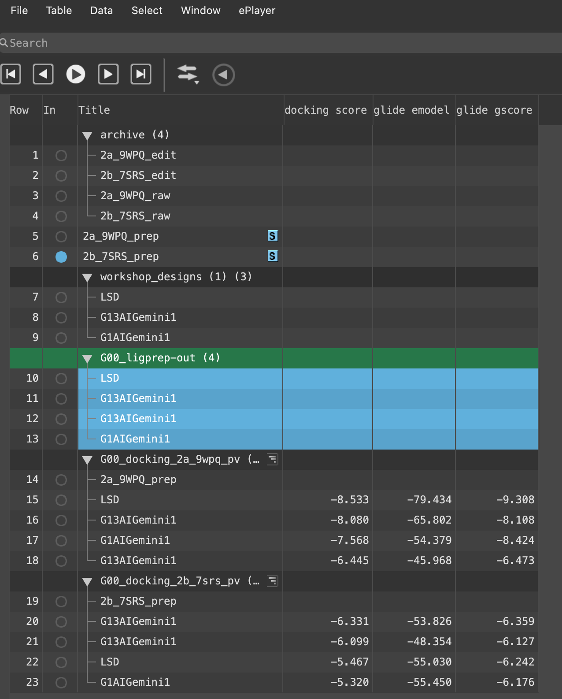
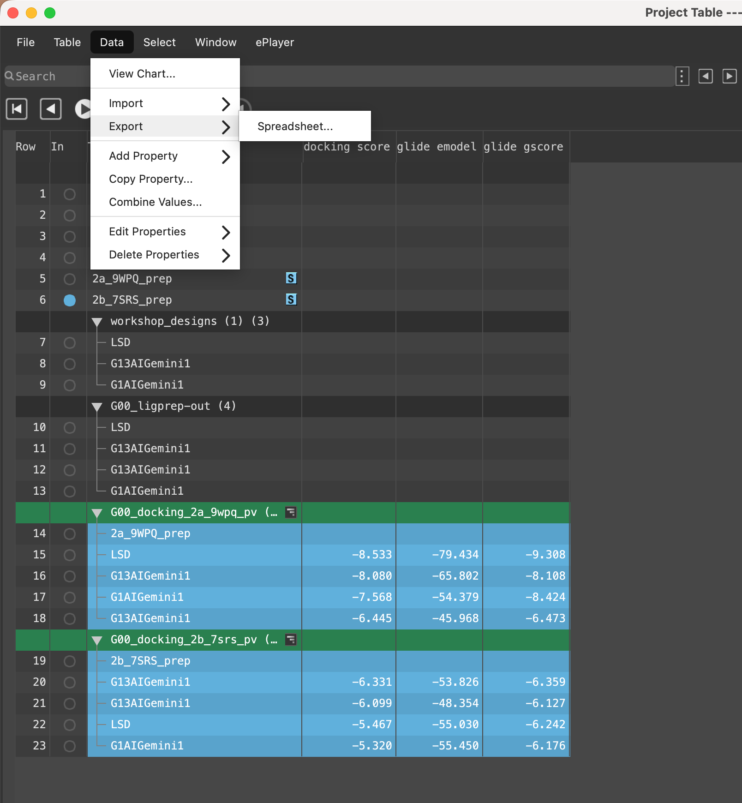
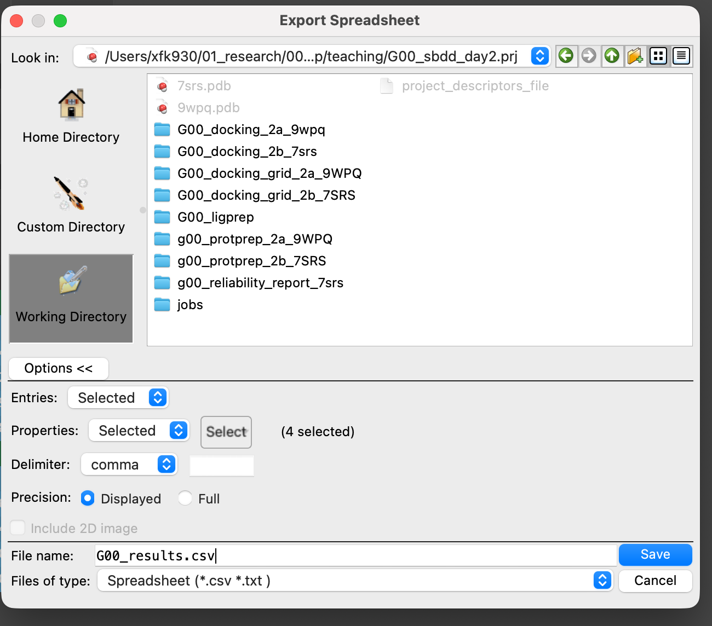

# 16 · Analyse poses and selectivity

**Goal:** look at the poses first, then let the numbers say what they can.

## 1. Look at the poses

Before any score: include the receptor, select all docked ligands, apply your presets, and look.

- Does the pose keep the salt bridge to the TM3 aspartate?
- Is your new substituent where you predicted it would be in step 08?
- Does the ergoline scaffold sit where LSD sits in the experimental structure?
- Does the pose look physically sensible, or is it threaded through something?

> **Discuss** — find the pose that most clearly contradicts the hypothesis that produced it. What did the molecule do instead of what you expected? That is usually more informative than the one that worked.
> {: .discuss }

## 2. Get the scores out

1. Click **Table**, or press `Ctrl`/`Cmd` + `T`, for the full Project Table.


2. In the property tree, hide all properties.



3. Show only **Glide → Primary**.





4. Select both docking result groups, then **Data → Export → Spreadsheet (CSV)**.





## 3. Run the numbers

Open the **[selectivity calculator](selectivity.md)**, drop in your exported CSV, and it will do the arithmetic and rank your compounds.

It is worth knowing what it is doing, because it is three lines of arithmetic:

**Score difference.** How much better a compound scores against 2A than against 2B:

```
ΔScore = score(2B) − score(2A)
```

Scores are negative, so a **positive ΔScore favours 2A**.

**From score to a binding constant.** Treat the docking score as if it were a binding free energy:

```
Ki = exp(score / RT)        RT = 0.5925 kcal/mol at 298.15 K
```

The answer comes out in molar because the formula assumes a 1 M standard state. That is where the units come from — they are a convention in the equation, not something that was measured.

**Fold selectivity.** The ratio of the two:

```
fold = Ki(2B) / Ki(2A) = exp(ΔScore / RT)
```

### Worked example

Using the LSD control from a real run:

| | 2A | 2B |
| --- | --- | --- |
| Docking score (kcal/mol) | −8.533 | −5.467 |
| Estimated Ki | 0.55 µM | 98 µM |

ΔScore = −5.467 − (−8.533) = **+3.07 kcal/mol**, so fold = exp(3.07 / 0.5925) ≈ **177-fold** predicted selectivity for 2A.

Two things are wrong with that, and both are worth more than the ranking.

**The affinity is wrong.** LSD's measured affinity at 5-HT2A is in the low nanomolar range. The calculation says 0.55 µM — out by more than two orders of magnitude, for the molecule the structure was *solved with*.

**The selectivity is wrong too, and in the direction that matters.** The pipeline has just declared LSD 177-fold selective for 2A. But LSD binds 5-HT2B perfectly well — well enough that 7SRS, one of your two starting structures, is an LSD–5-HT2B complex. Look up the reported affinities at both receptors and work out the real ratio. It is nothing like 177.

> **Discuss** — the pipeline got LSD's affinity wrong by orders of magnitude, and then invented a large selectivity for a molecule that is not selective. A difference of two unreliable numbers is only more reliable than either one if their errors cancel, which needs the two calculations to be wrong in the *same way*. Two separately prepared receptors, two separately built grids: are they? And if the control's ΔScore is this far off, what does your own compound's ΔScore entitle you to claim?
> {: .discuss }

This is not a reason to throw the numbers away. It is the reason you looked at the poses first.

**Checkpoint**

- [ ] You have looked at every pose before looking at any score.
- [ ] The CSV is exported with Glide primary properties.
- [ ] The calculator has ranked your compounds.
- [ ] Your group can explain why the estimated Ki is not a prediction of affinity.
- [ ] You have checked the control's ΔScore against LSD's real selectivity.

[Previous](15-Dock-to-both-receptors.md) · [Workshop home](index.md) · [Next: ranking and debrief](17-Ranking-and-debrief.md)
