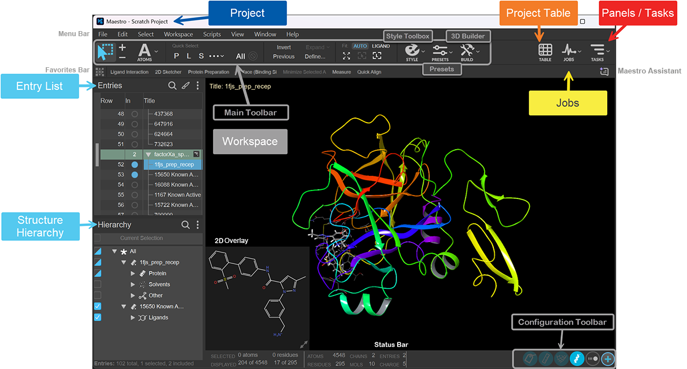
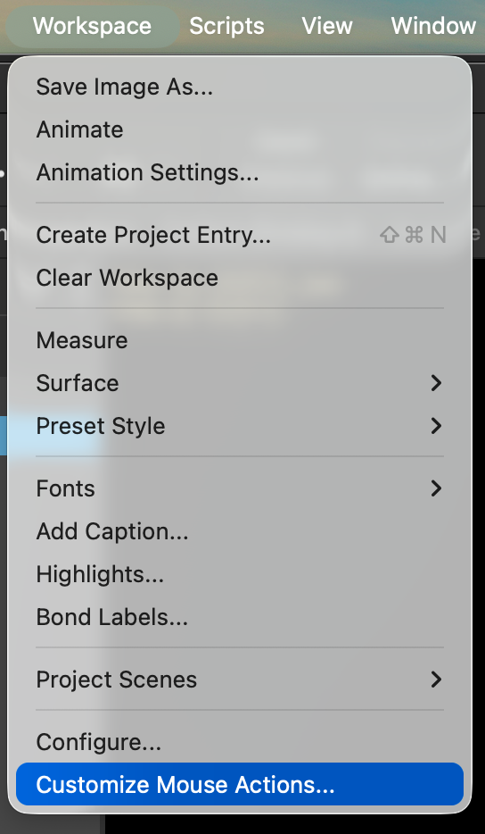
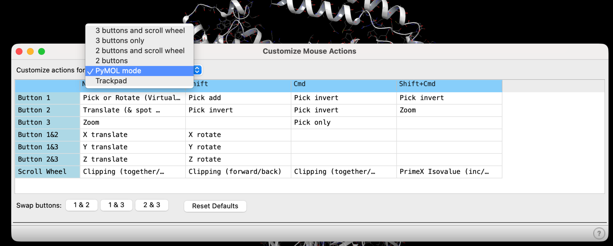
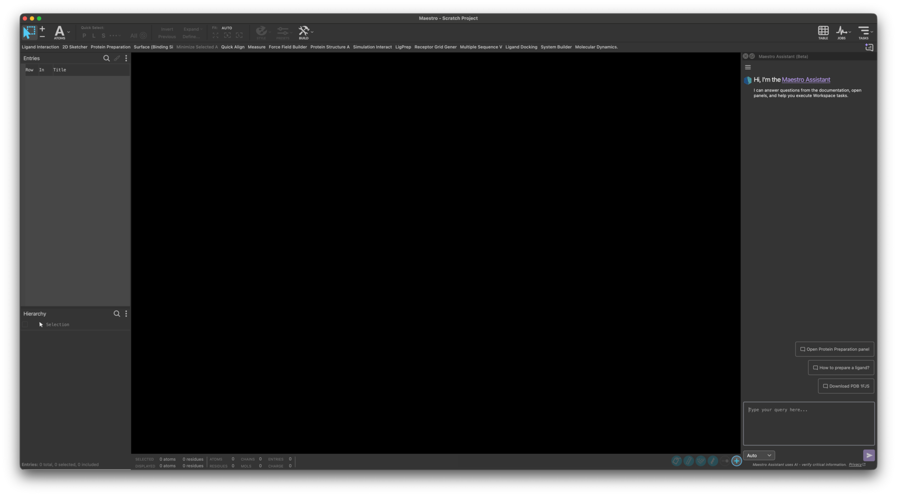

# Maestro basics

A reference page, not a step. Skim it before the workshop and come back whenever the interface gets in your way.

## The interface

This is Maestro 2026-4. Releases move things around, so if a menu is not where a screenshot shows it, use **TASKS** and search for the tool by name.

| Area | What it is for |
| --- | --- |
| **Workspace** | The 3D view in the middle. What you see here is what is *included*. |
| **Entry List / Project Table** | Every structure in the project and its properties. Open the full table with `Ctrl`/`Cmd` + `T`. |
| **Hierarchy** | The contents of the included entries, broken down into chains, residues, molecules and atoms. This is where you select things to delete. |
| **TASKS** | Searchable list of every calculation. If you cannot find a panel, search here. |
| **JOBS** | Running and finished calculations, with their log files. |
| **STYLE / PRESETS** | How structures are drawn. Presets apply a whole display scheme at once. |
| **BUILD** | Edit atoms, bonds and formal charges directly. |

## Selected, included, displayed

Three different things, and mixing them up causes most of the confusion on Day 2:

- **Selected** entries are highlighted in the Project Table. Most tasks that say "selected entries" mean these.
- **Included** entries are shown in the Workspace. The filled circle in the **In** column controls this.
- **Displayed** atoms are the ones currently drawn. Hiding atoms changes only the picture.

Hiding or excluding changes what you see. **Deleting changes the structure** and goes into your calculation. Always keep an untouched copy of anything you edit.

## Moving around

Rotate, translate and zoom:

<video controls loop muted playsinline preload="metadata">
<source src="assets/maestro-mouse-actions.mp4" type="video/mp4">
Your browser cannot play this video.
</video>

Selecting atoms and residues:

<video controls loop muted playsinline preload="metadata">
<source src="assets/maestro-mouse-select.mp4" type="video/mp4">
Your browser cannot play this video.
</video>

### If the mouse feels wrong

You can reassign every mouse action.

If you already know PyMOL, switch to **PyMOL mode** and keep the muscle memory you have.

## Ask the built-in assistant

> 💬 **Maestro Assistant** — the chat icon in the top right, just below **TASKS**. It answers questions from the documentation, opens panels for you and explains what a setting does. When you are stuck mid-workshop, ask it before you ask us. Like any AI assistant it is confidently wrong sometimes, so check anything that matters.
> {: .tip }

## Cheat sheets

Keep one of these open on a second screen:

- [Maestro quick reference card (PDF)](downloads/maestro-quick-reference.pdf) — one page, every shortcut.
- [First steps in Maestro (PDF)](downloads/maestro-first-steps.pdf) — guided introduction.
- [Key concepts and features of Maestro (PDF)](downloads/maestro-key-concepts.pdf) — the vocabulary.

[Workshop home](index.md) · [Set up Schrödinger](setup.md)
