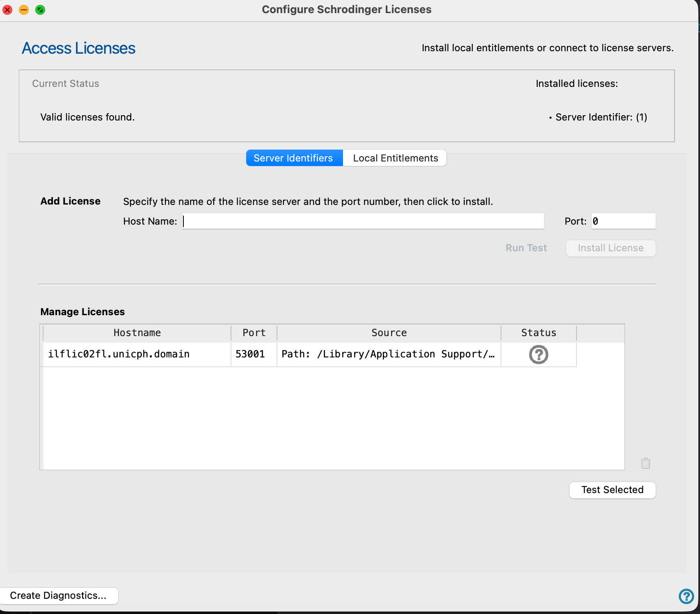
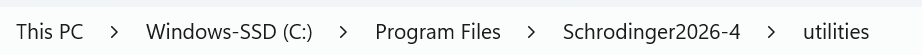
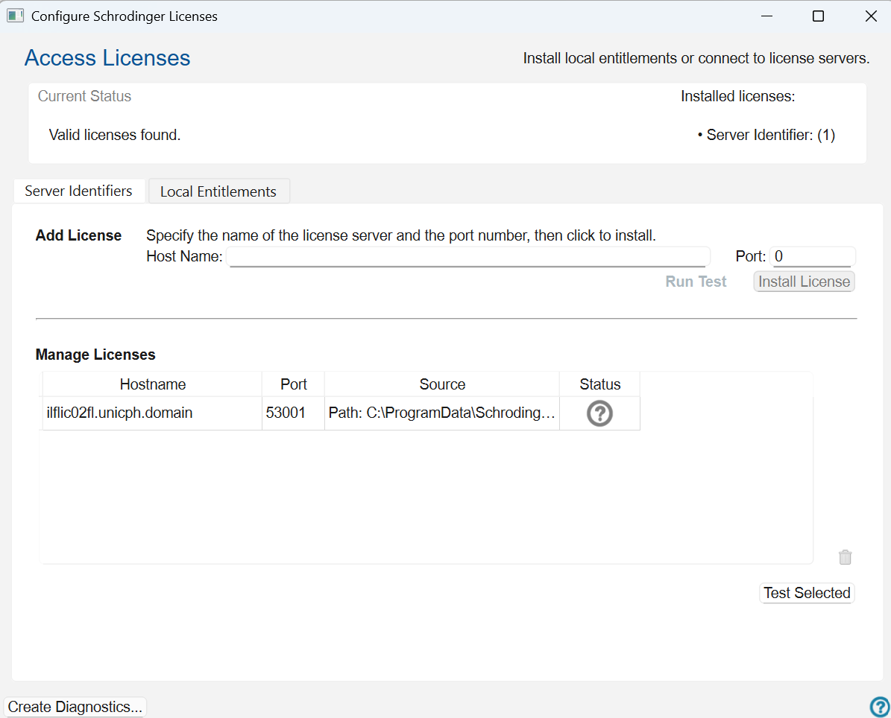

# Set up Schrödinger before the workshop

**Do this before Day 2.** Installing and licensing takes longer than you expect, and the workshop starts with structures already on screen.

Everyone installs the full Schrödinger suite, not only Maestro, so that Protein Preparation, LigPrep and Glide are available. How you license it depends on your affiliation:

- **[KU participants](#ku-participants)** connect to the university licence server through the KU VPN.
- **[External participants](#external-participants)** install a machine-locked licence on their own computer, with no VPN.

The PDFs linked below are Schrödinger's own documentation for Release 2026-4, the version used in this guide.

## KU participants

### 1. Connect to the KU VPN

The licence server only answers from inside the university network. Install the KU VPN client from the [KU IT self-service pages](https://kunet.ku.dk) and sign in with your KU credentials.

Stay connected to the VPN whenever you run Maestro, including during the workshop. If jobs suddenly fail to start, check the VPN first.

### 2. Install the software

You will receive a download link with installers for macOS, Linux and Windows. The install guides walk through each installer screen:

- [Mac install guide (PDF)](downloads/schrodinger-install-mac.pdf)
- [Windows install guide (PDF)](downloads/schrodinger-install-windows.pdf)

Follow them for the installation only. You do not need their account and trial-licence steps, or the machine-locked licence instructions, because you use the KU licence server.

### 3. Point it at the licence server

The licence address is the same on every platform:

```
53001@ilflic02fl.unicph.domain
```

**macOS:** open **Applications → Schrodinger Suites *release* → Configuration** and enter the licence address.



**Windows:** open **Start → All apps → Schrodinger *release* → Configure Software** and enter the same address.





**Linux:** add the licence to your shell profile, for example in `~/.bashrc`:

```bash
export SCHROD_LICENSE_FILE="53001@ilflic02fl.unicph.domain"
```

Open a new terminal, or run `source ~/.bashrc`, for the change to take effect.

## External participants

A machine-locked licence works only on the computer it is installed on, so install everything on the computer you will bring to the workshop.

### 1. Download the software

Set up a free [Schrödinger account](https://my.schrodinger.com/request-account) with your institutional email, then [download the software](https://my.schrodinger.com/download/software/).

### 2. Install the software

Follow the install guide for your computer:

- [Mac install guide (PDF)](downloads/schrodinger-install-mac.pdf)
- [Windows install guide (PDF)](downloads/schrodinger-install-windows.pdf)

### 3. Install your licence

Your licence key comes by email from Schrödinger. The full instructions, with screenshots, are in the licence guide for your computer:

- [Mac machine-locked licence guide (PDF)](downloads/schrodinger-machine-locked-licence-mac.pdf)
- [Windows machine-locked licence guide (PDF)](downloads/schrodinger-machine-locked-licence-windows.pdf)

In short:

1. Open the **Configure Schrödinger Licenses** app. The installer offers it when it finishes, or use **Help → Configure Schrodinger Licensing** in Maestro.
2. Select the **Local Entitlements** tab.
3. Under **Add License**, leave **Start with** on **Key Text**, paste the key from your email and click **Install License**.
4. Check that the licence appears under **Manage Licenses**, with its start date, expiry date and machine ID.

You need write permission to Schrödinger's licence folders, which the guides list. On a managed laptop you may need an administrator.

You can also install and test the licence from the command line. On macOS, in Terminal:

```bash
/opt/schrodinger/suites2026-4/licadmin install -k <key>
/opt/schrodinger/suites2026-4/utilities/lictest -d MAESTRO_MAIN
```

On Windows, in the Schrödinger Command Prompt:

```
licadmin install -k <key>
lictest -d MAESTRO_MAIN
```

`lictest` reports the available licences and their current usage.

**Linux:** there is no PDF for this route. Use the Linux tab of [Schrödinger's online licence instructions](https://learn.schrodinger.com/private/edu/release/current/Documentation/html/licensing/licmgr-machine_locked_install.htm), signing in to your account if asked.

## Check that it works

- [ ] KU participants only: the VPN is connected.
- [ ] Maestro opens without a licence warning.
- [ ] **TASKS** finds *Protein Preparation Workflow*, *LigPrep* and *Ligand Docking*.

> **Still stuck?** Bring your laptop to the start of the session and ask an instructor. Do not spend the workshop fighting the installer — we have checkpoint files and spare machines.
> {: .warn }

[Workshop home](index.md) · [Maestro basics](maestro-basics.md)
