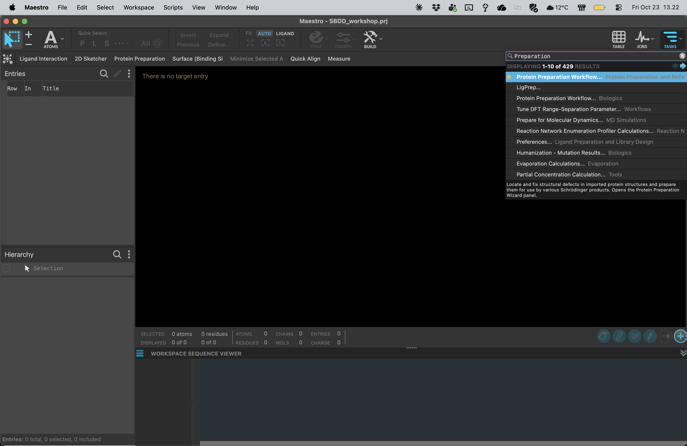

# 01 · Get to know Maestro

**Goal:** find the controls you will use throughout the workshop.

1. Open Maestro on your teaching desktop or computer.
2. Find the **Workspace**, where molecules are displayed, and the **Entry List / Project Table**, where structures and their properties are stored.
3. Find **TASKS** and search for **Protein Preparation Workflow**. Close the panel again after locating it.
4. Find **JOBS**, where you will monitor preparation and docking calculations.
5. Check the mouse configuration for your mouse or trackpad. Once structures are loaded in step 03, practise rotating, translating, zooming and fitting the view.

**Three different actions:** selecting an entry chooses it for an operation; including an entry displays it in the Workspace; selecting atoms chooses part of a structure. Many tasks use either selected Project Table entries or included Workspace entries. Always check the task's input selector before running it.

Hiding or excluding a structure changes the display. Deleting atoms changes the structure. Keep original entries so you can recover from editing mistakes.

**Checkpoint:** point out TASKS, JOBS, the Workspace and the Project Table to your partner.

[Home](Home.md) · [Next: create a project](02-Create-project.md)
