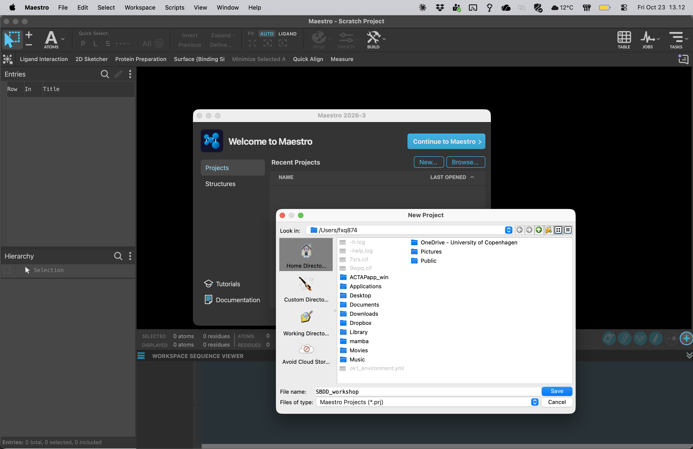

# 02 · Create a project

**Goal:** keep structures, calculations and notes together under your group ID.

1. Create a writable folder such as `G04_SBDD` on your teaching desktop or assigned storage.
2. Use the welcome screen's **New Project** action or **File → New Project**, depending on your release. Save it as `G04_SBDD.prj` using **Save Project As** if needed.
3. Set **File → Change Working Directory** to your group folder. Job files are distinct from the Maestro project; keep both in this folder.
4. Download the [group worksheet in Word or Excel](Group-worksheet.md) and save a group copy in your working folder. Record group members, Maestro release and working folder. Use the GitHub Pages submission app to submit SMILES later in step 13.
5. Save your project after each major checkpoint. Use descriptive structure titles such as `2A_9WPQ_raw`, `2A_9WPQ_clean` and `2A_9WPQ_prepared`.

Use the same prefix for files and jobs, for example `G04_ligprep`, `G04_2A_grid` and `G04_2B_SP`. Avoid spaces in job names.

**Checkpoint:** the project has a name, the working directory is writable, and your partner knows where to find the files.

[Previous](01-Maestro-interface.md) · [Home](Home.md) · [Next: fetch structures](03-Fetch-structures.md)
