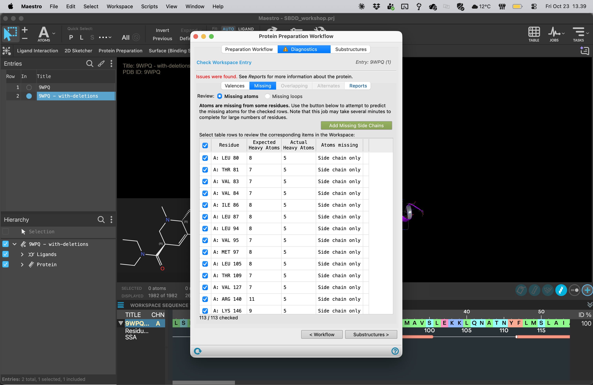

# 04 · Inspect protein preparation diagnostics

**Goal:** understand what the experimental coordinates contain and what preparation needs to repair.

1. Include only the 9WPQ working copy. In **Protein Preparation Workflow**, select it as input and choose **Review Structure**.
2. Open **Diagnostics** and inspect **Missing**. Select reported residues to locate them in the structure.
3. Distinguish missing hydrogens, incomplete side chains, unresolved residues and absent terminal regions. Ask whether each issue is near LSD or remote from the binding site.
4. Inspect **Reports**, changing the report dropdown to review the available checks, including any reported clashes, alternate positions, bond-order or geometry issues.
5. Locate the seven-transmembrane receptor and the associated proteins. Record which chain is the receptor before deleting anything.
6. Repeat the inspection for the 7SRS working copy.

| Finding | Question to answer |
| --- | --- |
| Missing hydrogens | How will protonation and hydrogen-bond assignments be chosen? |
| Missing side-chain atoms | Does the residue contact LSD or define the pocket? |
| Missing loop or terminus | Is it remote, or could it shape the binding-site entrance? |
| Alternate positions or clashes | Which interpretation will the common preparation use? |
| Missing water density | Does absence of a modeled water mean that no water occupies this region? |

Preparation can add a plausible model for missing features; it cannot recover experimental evidence that is absent. The [Protein Preparation Workflow overview](https://www.schrodinger.com/life-science/learn/white-papers/protein-preparation-workflow/) explains the repair and refinement operations.

Do not rebuild long loops automatically during the live exercise. If a missing segment borders the pocket, ask the instructor whether to use the common prepared model and record the uncertainty.

**Checkpoint:** record at least two diagnostic observations and explain whether they could affect docking.

[Previous](03-Fetch-structures.md) · [Home](Home.md) · [Next: remove unwanted chains](05-Remove-unwanted-chains.md)
