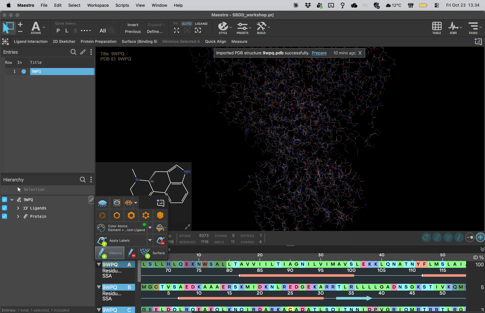

# 05 · Remove unwanted chains

**Goal:** make one receptor–LSD working complex for each subtype.

1. Work on a duplicate, with the raw entry excluded. Show ribbons and use the hierarchy or sequence viewer to inspect individual chains. You can also use the Substructures panel in the Protein Preparation Workflow window.
2. Identify the receptor by its seven transmembrane helices and its chain annotation.
3. Select the other **protein chains** and delete those atoms from the working copy. Excluding their display alone will leave them in the calculation input.
4. Keep the receptor and **7LD (LSD)**. Check the ligand explicitly after deleting chains: in mmCIF, a ligand can have a separate label chain from its receptor.
5. Inspect any remaining non-protein components. For the common workshop baseline, remove waters and unrelated buffer, lipid or sugar components; retain receptor disulfides and consult the instructor before changing a covalent modification or essential cofactor. Record what you remove.
6. Rename the entries `2A_9WPQ_clean` and `2B_7SRS_clean` and save.

Use this lookup to check your identification; Maestro may display author IDs or mmCIF label IDs:

| Entry | Receptor author chain | Receptor label chain | LSD author / label chain |
| --- | --- | --- | --- |
| 9WPQ | A | A | A / F |
| 7SRS | R | C | R / H |

These mappings come from the [9WPQ entry](https://www.rcsb.org/structure/9WPQ) and [7SRS entry](https://www.rcsb.org/structure/7SRS). In particular, chain A in 7SRS is an antibody light chain under label numbering. Identify chains independently in each complex.

**Checkpoint:** include each cleaned entry alone. You should see one seven-helix receptor with LSD in its pocket and no transducer or antibody proteins. Inspect the hierarchy to confirm that hidden components have also been removed.

[Previous](04-Protein-diagnostics.md) · [Home](Home.md) · [Next: align receptors](06-Align-receptors.md)
