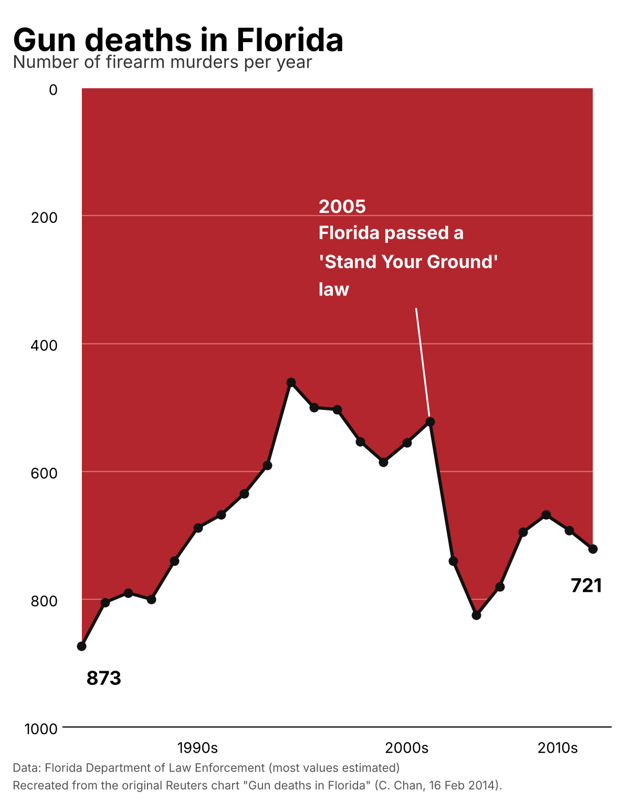
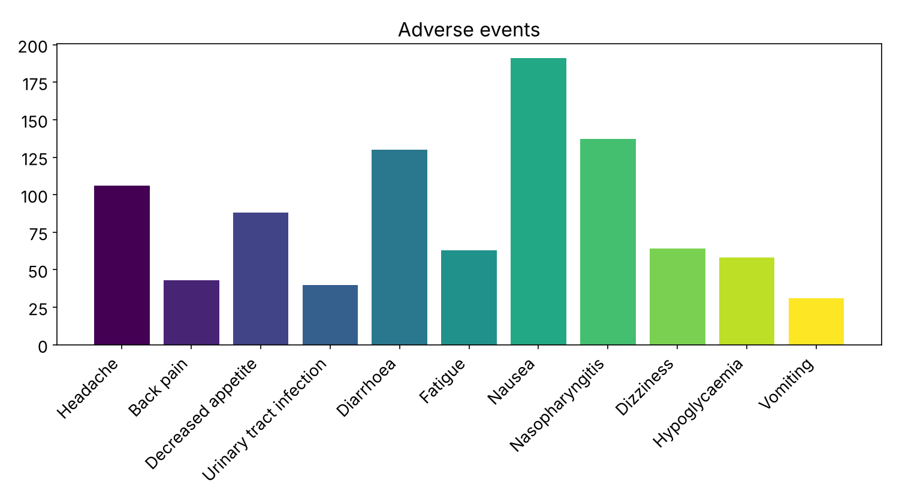
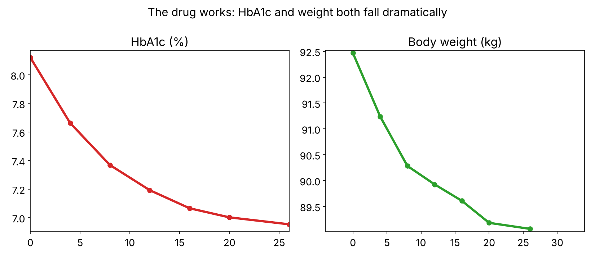
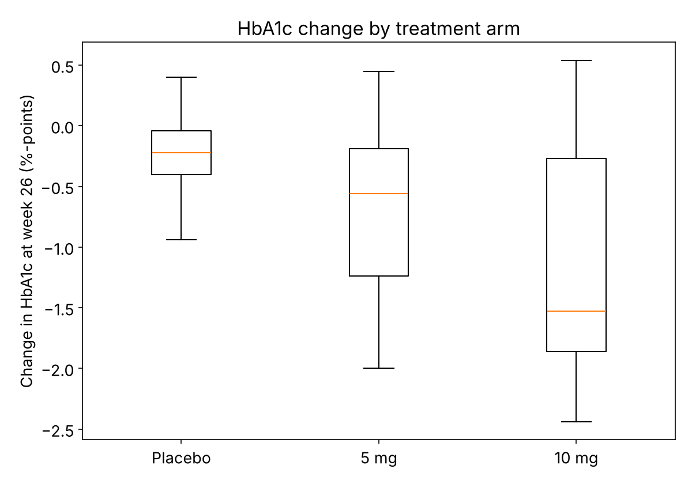
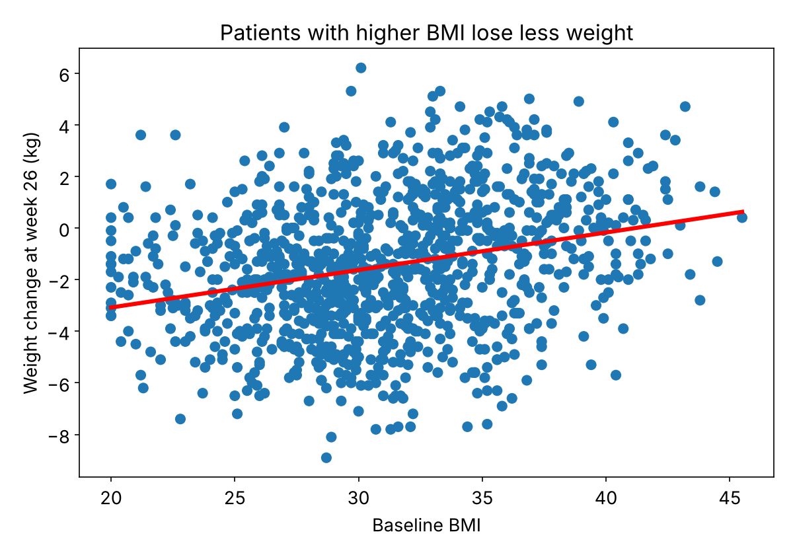

# Workshop 4: Data visualization

## Intro & Warm-up

> **What will happen?** Over four rounds, you’ll use Claude to create and improve charts. Each round includes a flawed chart to improve and a dataset to use to create your own chart from scratch. Upload your favourite solutions anonymously, and we’ll look at the results together.
> {: .tip }

## The workshop in 3 rounds

<a class="button primary" href="https://miro.com/app/board/uXjVEUBBZ9o=/?share_link_id=345739221005">Open the Miro board →</a>

### Round 0

This is a test round to see if everything works for you. Follow the steps described below to generate and share another version of the chart.

| Preview | Task | Resources |
| --- | --- | --- |
|  | • Talk to your neighbors and identify flaws in the chart. • Prompt Claude to improve it or make a new chart. • Paste your favourite solutions to Miro. | [Data (CSV)](downloads/R0.csv) [Chart (PNG)](downloads/R0.png) |

### Example prompt to copy

Your prompt should cover the input, what should be changed, and the output.

<button class="button secondary" type="button" data-copy-target="round-zero-prompt">Copy prompt</button>

<pre id="round-zero-prompt"><code>Attached are a chart (PNG) and it's data (CSV).
Change the chart in the following way:

- flip the charts y-axis, so that 0 starts at the bottom.
- instead of filling the area, make the line red.
- use light grey grid lines
- 2005 marker: a thin dashed line
- X-axis ticks should have labels for every second year
- dots that are labelled with data should be solid, other dots should only have an outline
- reduce white space between y-axis ticks
- use a red with high transparency to cover the area under the curve
Use only my data. Output PNG and Code, then list what you changed in 2-3 lines.</code></pre>

### Round 1

After getting to know the workflow, the creative part begins now. All the following rounds will use the same data set about a type 2 diabetes drug trial. It is not important that you understand the data set in detail, as it is only a means to explore different visualizations that can be created from it. Still, you can read up on it in the data_dictionary.md (part of the workshop_data.zip) if you are interested or let Claude explain it to you.

The example plots in this round have some design flaws. Discuss in a group with the people next to you what and how they can be changed. Then prompt Claude to implement the changes and upload your favorite solutions to Miro.

| Preview | Task | Resources |
| --- | --- | --- |
|   | • Identify flaws in the charts. • Prompt Claude to improve them. • Paste your favourite solutions to Miro. | [Workshop data (ZIP)](downloads/workshop_data.zip) [Chart A (PNG)](downloads/R1a.png) [Chart B (PNG)](downloads/R1b.png) |

### Round 2

Again, the same dataset is used and represented by charts that could use some improvements. Are these charts representing the data correctly?

| Preview | Task | Resources |
| --- | --- | --- |
|   | • Identify flaws in the charts. • Prompt Claude to improve them. • Paste your favourite solutions to Miro. | [Workshop data (ZIP)](downloads/workshop_data.zip) [Chart A (PNG)](downloads/R2a.png) [Chart B (PNG)](downloads/R2b.png) |

### Round 3

Now you are free to design your own chart(s). You can get inspirations from these chart galleries.

<strong>Chart galleries for inspiration</strong>Explore chart types, examples and caveats.

<a class="button secondary" href="https://www.data-to-viz.com/">Data to Viz ↗</a> <a class="button secondary" href="https://datavizproject.com/">Data Viz Project ↗</a> <a class="button secondary" href="https://100.datavizproject.com/">100 Data Viz Project ↗</a> <a class="button secondary" href="https://www.data-to-viz.com/caveats.html">Chart caveats ↗</a>

The data set is large, so you have to decide what aspects of it to put in your chart.

| Task | Resources |
| --- | --- |
| • Make your own charts for this data. • Optional: use your own data. • Get inspired by chart galleries above. • Paste your favourite solutions to Miro. | [Workshop data (ZIP)](downloads/workshop_data.zip) |

## Closing

Discuss in groups: What were your most important insights? What tips would you share?

Share your insights and tips with everyone.
